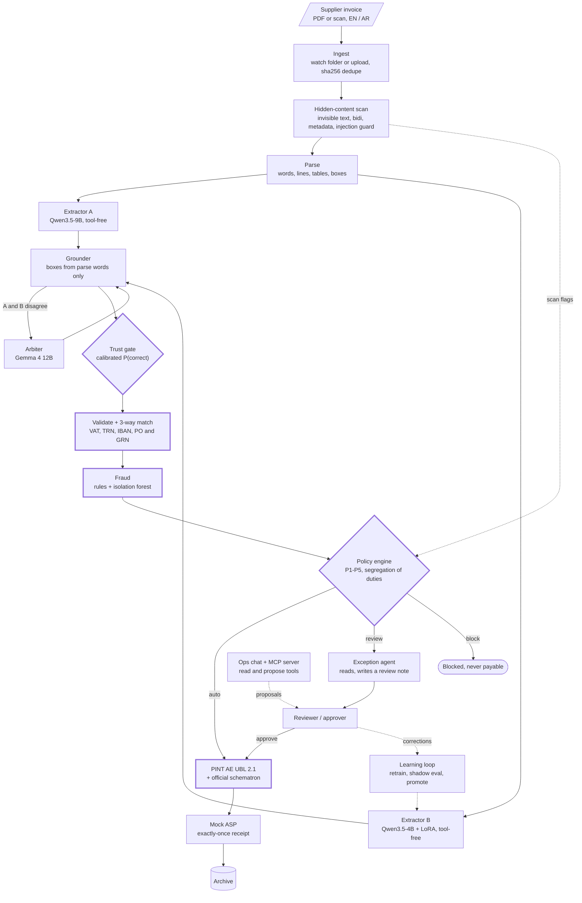

<h1 align="center">Sovereign AP Autopilot</h1>

<p align="center">
  <strong>A local-only accounts-payable agent.</strong><br/>
  Supplier invoices in English and Arabic become validated UAE PINT AE e-invoices,<br/>
  with fraud checks, a provable field error rate and payments a prompt injection cannot redirect.
</p>

<p align="center">
  <a href="https://github.com/AdityaAg8/sovereign-ap-autopilot/actions/workflows/ci.yml"></a>
  <a href="LICENSE"></a>
  
  
  
  
</p>

<p align="center">
  <a href="#quickstart">Quickstart</a> ·
  <a href="#how-it-works">How it works</a> ·
  <a href="#security-model">Security model</a> ·
  <a href="#evaluation-and-quality-gates">Evaluation</a> ·
  <a href="#project-status">Status</a> ·
  <a href="docs/README.md">Docs</a>
</p>

> [!NOTE]
> `v1.0`: the pipeline runs end to end on a live stack, and every number below is measured and
> linked to its report, failed gates included. In the live runs no invoice was paid without a
> human approval: each was either blocked or held for review by the trust gate, the approval
> limit or a fraud or injection signal. Deferred work is listed in [ADR-0020](docs/adr/0020-v1-scope-and-deferred-items.md)
> and [`KNOWN_ISSUES.md`](KNOWN_ISSUES.md). New here? Start with [Getting started](docs/getting-started.md).

---

## Why

The UAE e-invoicing mandate requires PINT AE (UBL 2.1) invoices exchanged through accredited
service providers: large businesses from 1 January 2027, everyone else from 1 July 2027. Most AP
teams receive supplier invoices as PDFs or scans, often bilingual, and someone has to turn each
one into a correct structured invoice before it can be paid.

Doing that with language models raises three questions a finance team will ask first:

1. **Where does the data go?** Nowhere. Every model, the OCR, the database and the workflow
   engine run in local containers on one 12 GB laptop GPU. The app network has no route out, and
   a test proves it.
2. **How often is it wrong?** Each field gets a calibrated probability of being correct. A
   Learn-then-Test threshold bounds the error rate among the fields it accepts without review
   (target: at most 1% with 95% confidence), and anything below the threshold goes to a person.
3. **Can a malicious invoice steal a payment?** Payment decisions never depend on model output
   alone. The payee always comes from an admin-verified account in the vendor master, approvals
   need a human with the right role, and the models that read documents have no tools to call.

<p align="center">
  
  
  
</p>
<p align="center"><sub>Invoices from the built-in synthetic factory: 12 layouts across English, Arabic-first and bilingual, five UAE tax cases, 30% rendered as scans.</sub></p>

## Highlights

Every number below is measured and links to the report that produced it. Nothing is estimated.

| Area | Result | Gate | Source |
|---|---|---|---|
| Extraction (Extractor A, Qwen3.5-9B) | 99.60% valid JSON; 99.24% field accuracy on 750 UAE test invoices (480 with Arabic text) | valid JSON ≥ 99% | [`extraction_a.md`](reports/extraction_a.md) |
| Extractor B (Qwen3.5-4B LoRA, round R1b) | UAE test: field F1 93.23% vs Extractor A 92.75% (Arabic 98.38% vs 96.66%), 100% valid JSON, p50 16.35 s vs A's 26.04 s. Not promoted: it misses the latency gate P2 (limit 0.60 × A = 15.62 s), so A stays the champion | all five promotion gates (ADR-0015): 4 of 5 pass | [`extractor_b_gates.md`](reports/extractor_b_gates.md) |
| Trust gate (calibrated, Learn-then-Test) | 0.54% error among auto-accepted fields at α = 1% (56 of 10,318); 98.3% of 10,500 fields straight through | ≤ 1% at δ = 5% | [`trust_gate.md`](reports/trust_gate.md) |
| Grounding | 92.69% of non-null fields matched to words on the page; 86.25% of boxes at IoU ≥ 0.5 | reported | [`extraction_a.md`](reports/extraction_a.md) |
| Parsing (born-digital) | 98.24% of 96,444 labelled fields at IoU ≥ 0.5; p50 187 ms per document | ≥ 98% | [`parse.md`](reports/parse.md) |
| E-invoice output | 5,000 / 5,000 gold PINT AE invoices pass the official schematron, across all five tax cases | 100% | [`gold_xml.md`](reports/gold_xml.md) |
| Fraud detection | Recall at 1% FPR of 92-100% on each of 8 typologies, minimum over 3 seeds | ≥ 90% per typology | [`fraud.md`](reports/fraud.md) |
| Live end-to-end run | 18 of 18 factory invoices archived (UBL built, schematron passed, sent, archived) and 2 of 2 attack PDFs kept out of payment (one only because its workflow failed before routing) | reported | [`e2e_pipeline.md`](reports/e2e_pipeline.md) |
| Attack suite, end to end | 312 attack PDFs in 12 categories through the live stack: 0 of 308 conclusive cases changed a payment. 4 ended `failed` (3 extractions with no totals, 1 mock-ASP resend conflict), with no invoice paid; the gate counts a failed workflow as inconclusive | payment-changing ASR = 0 with every case conclusive: **FAIL_INCOMPLETE** | [`attacks_e2e.md`](reports/attacks_e2e.md) |
| Demo | 9 of 9 staged scenarios met their expected outcome: 2 poisoned invoices blocked, a duplicate and a bank-change invoice held, 5 clean and bilingual invoices archived after approval | all | [`demo.md`](reports/demo.md) |
| Real documents (ExtractBench short, public) | Extractor A zero-shot: value F1 70.39% on the 245 real documents (95% CI 66.54-73.88%), 91.67% valid JSON; the 21 failures are long tables whose answer outgrows the 4,096-token output limit. The authors' published 92.31% comes from their own harness and is not comparable | reported, never gated | [`real_extractbench.a-base.md`](reports/real_extractbench.a-base.md) |
| Real receipts (CORD v2, public) | Extractor B R1b, trained on CORD's train split: field F1 90.70% on its test split (95% CI 87.64-93.35%, n=100); Extractor A zero-shot: 46.16% | reported, never gated | [`real_cord.b-r1b.md`](reports/real_cord.b-r1b.md) |
| GPU budget | 7 of 7 runtime models load and serve; stage peaks 1.4-9.7 GB | ≤ 11.8 GB whole card | [`smoke.md`](reports/smoke.md) |
| Training data | 99.87% of 629,210 factory labels match the PDF text at their box | ≥ 99.5% | [`factory_selfcheck.md`](reports/factory_selfcheck.md) |

## How it works

One durable Temporal workflow runs per invoice. Models propose values; deterministic code decides
what happens to money.



<sub>Thick outline: deterministic checks. An invoice goes straight through only if every field
passes the trust gate and validation, fraud and policy all pass.</sub>

| Stage | What happens | Module |
|---|---|---|
| Ingest | Watches `data/inbox/` and takes uploads (PDF, PNG, JPEG, ≤ 20 MB, ≤ 30 pages); one workflow per sha256 | `apx/ingest` |
| Scan | Finds text a reader cannot see (invisible fill, tiny or off-page text, text behind images), zero-width and bidi controls, PDF metadata, attachments and JavaScript | `apx/scan` |
| Parse | pdfplumber for born-digital PDFs, PaddleOCR-VL-1.6 for scans | `apx/parse` |
| Extract | Two different models read each invoice under a JSON schema with no tools; an arbiter settles disagreements | `apx/extract` |
| Trust gate | Per-field features (A/B agreement, token logprobs, format, OCR support), isotonic calibration, Learn-then-Test threshold | `apx/trust` |
| Validate | VAT per line and total for every tax case, TRN, AE IBAN mod-97, mandatory fields, 3-way match against PO and GRN | `apx/validate` |
| Fraud | Duplicates, near-duplicates, split invoices, bank-detail changes, vendor impersonation, price anomalies, isolation forest | `apx/fraud` |
| Policy | Routes auto, review or block; authorises every payment-affecting action | `apx/policy` |
| E-invoice | Builds PINT AE UBL 2.1, validates it against the pinned PINT AE 1.0.4 schematron | `apx/einvoice` |
| Send and archive | Mock accredited service provider: idempotent receipt, 5-year retention metadata | `apx/asp_mock` |

**Around the pipeline.** Every decision appends to a hash-chained audit log in Postgres with an
independent anchor chain, so an edited or truncated history is detected (`python -m apx.audit verify`).
OpenTelemetry traces every workflow step and model call to Arize Phoenix. MLflow holds the model
registry with `champion` and `challenger` aliases. llama-swap serves the models one pipeline stage
at a time, and a preflight check refuses to load a stage into a card without room for it.

**Review UI.** A Next.js app with an inbox, a review queue, invoice detail with each field's box on
the page image, fraud-flag explanations, an operations board and an assistant panel. It is
keyboard-first: press `?` on any screen for its shortcuts.

**Agent, chat and MCP.** The exception agent and the ops chat use six typed tools over
parameterised SQL and a read-only database role with masked views. Every tool either reads or
creates a proposal; a proposal changes nothing until a person with the right role accepts it. The
MCP server exposes the same tools, with a JWT per call and every read audited. Answers cite the
audit events they relied on.

<details>
<summary><strong>Models</strong> (all Apache-2.0 at runtime)</summary>

| Role | Model | Stage |
|---|---|---|
| Parse | PaddleOCR-VL-1.6 | parse |
| Injection guard | ModernBERT-base, fine-tuned here | scan |
| Extractor A, exception agent, ops chat | Qwen3.5-9B (GGUF) | extract, agent |
| Extractor B | Qwen3.5-4B + our LoRA | extract |
| Arbiter | Gemma 4 12B (QAT Q4_0) | arbitrate |
| Text embeddings | Qwen3-Embedding-0.6B | fraud, chat |
| Page similarity | Qwen3-VL-Embedding-2B | fraud |

Revisions, file hashes and licenses are pinned in [`infra/models.lock.json`](infra/models.lock.json);
`make models` verifies every weight file against it. Offline-only models (bake-off challengers,
red-team generator, guard baselines) and datasets are listed in [`docs/licenses.md`](docs/licenses.md).

</details>

## Security model

The design assumes every document is written by an attacker. Detection helps, but payment safety
does not depend on it: each path to a payment ends at a deterministic check.

**Typed boundary.** Extractors and the arbiter can only issue structured requests, which have no
`tools` field. Their output is a schema with `extra="forbid"`: a model cannot add an "approved"
field or supply its own boxes, which come from parse words (invariant I1). The agent sees document
text only as quoted, length-capped `UntrustedText` blocks (I2).

**Policy rules.**

| Rule | What it enforces |
|---|---|
| P1 | Pay only an IBAN an admin verified through a callback, never one taken from extraction. When a vendor has several verified accounts, the invoice IBAN (strict electronic form) may select exactly one of them and never introduces a new one. Anything else is a typed refusal. The selected payee is pinned at routing and re-checked when the e-invoice is built, so a change between approval and build stops the payment ([ADR-0014](docs/adr/0014-p1-multiple-verified-accounts.md)). |
| P2 | A bank-detail change routes that vendor's invoices to review, and the person who made the change cannot approve that vendor's payments for 30 days. |
| P3 | Amounts above the approval limit need the approver role. |
| P4 | Any scan or fraud flag above threshold routes to review; attack confidence above the block threshold blocks. |
| P5 | Agent and chat actions only create proposals; execution needs a human click by an allowed role. |

**Approvals are bound to what was approved.** A grant carries a digest of the invoice, the payee
IBAN and the match. If a money field is edited afterwards, the digest changes and the grant no
longer applies.

**No egress.** App containers sit on a Docker network with `internal: true`, host ports bind to
127.0.0.1, and [`tests/integration/test_no_egress.py`](tests/integration/test_no_egress.py) checks
that outbound calls fail. Models are downloaded on the host by `make models`, never by the running
stack.

**Adversarial suite.** 312 attack invoices in 12 categories (A01-A12: hidden white text, tiny
font, off-page text, text behind an image, zero-width characters, bidi override, homoglyph vendor,
IBAN-swap instruction, fake approval stamp, metadata injection, filename or email injection,
line-item injection) live in [`attacks/`](attacks/). Each category maps to its controls in the
[threat model](docs/security.md#7-attack-categories-m63--controls--proof).

Full threat model, STRIDE tables, attack trees and the control catalogue:
[`docs/security.md`](docs/security.md). Decisions: [ADR-0003](docs/adr/0003-trust-boundary.md),
[ADR-0008](docs/adr/0008-typed-boundary-and-capabilities.md),
[ADR-0014](docs/adr/0014-p1-multiple-verified-accounts.md). Reporting a vulnerability:
[`SECURITY.md`](SECURITY.md).

## Quickstart

### Requirements

| Requirement | Notes |
|---|---|
| NVIDIA GPU with 12 GB | Developed on an RTX 4080 Laptop GPU; one pipeline stage is resident at a time |
| Docker with GPU access | Docker Desktop (WSL2 backend) on Windows 11, or Docker Engine with the NVIDIA toolkit on Linux |
| [uv](https://docs.astral.sh/uv/) and Python 3.12 | Python dependencies, tests and tooling |
| Node.js and [pnpm](https://pnpm.io/) | The `web/` review UI |
| GNU make and bash | Git Bash on Windows |
| 32 GB RAM, about 150 GB free disk | Model weights, datasets and Docker images |

`bash scripts/preflight.sh` checks all of this and writes `reports/env.md`.

### Run it

```bash
make bootstrap   # .env with generated secrets, uv sync, pnpm install, pre-commit hooks
make up          # Postgres, Temporal, Phoenix, MLflow, llama-swap, parse, API and worker; waits for health
make models      # download model weights on the host and verify their hashes
make smoke       # check that every model loads and serves, writes reports/smoke.md
make seed        # load the factory ERP; sign-in details land in data/seed_credentials.json
make demo        # web app on http://localhost:3000 and nine staged invoices
make status      # one table: services, ports, GPU memory, loaded model, running jobs
```

[`docs/demo.md`](docs/demo.md) walks through the demo scenarios (clean, bilingual, poisoned,
bank change, duplicate) and what to look for in each.

**No GPU?** `make preview` runs the web UI against built-in fixtures on http://localhost:3001; the
login page lists the demo accounts.

> [!IMPORTANT]
> The worker writes our own 15-digit TRN as the e-invoice buyer and needs it in `WORKER_BUYER_TRN`.
> Compose defaults it to the demo company. Anywhere else there is no default, and the worker
> refuses to start without a valid value (see `.env.example`).

Step-by-step setup with checks after each step: [`docs/getting-started.md`](docs/getting-started.md).
Service URLs, recovery steps and the GPU budget: [`docs/runbook.md`](docs/runbook.md).

## Evaluation and quality gates

Splits are fixed by document sha256 in `evals/splits.json`, and a leakage test fails on any overlap
between train, calibration, test and external sets. Gates never move to make something pass; a
change needs an ADR with evidence ([ADR-0005](docs/adr/0005-eval-protocol.md)).

| Metric | Set | Gate | Measured | Status |
|---|---|---|---|---|
| Valid JSON rate | UAE test (750) | ≥ 99% | 99.60%, Extractor A ([report](reports/extraction_a.md)) | ✅ Pass |
| Schematron pass | All generated XML | 100% | 5,000 / 5,000 gold invoices ([report](reports/gold_xml.md)); 30 / 30 official samples | ✅ Pass |
| Fraud recall at 1% FPR | Factory typologies | ≥ 90% each | minimum 92.0% (near-duplicate) ([report](reports/fraud.md)) | ✅ Pass |
| Parse box IoU ≥ 0.5 | UAE test, born-digital | ≥ 98% | 98.24% ([report](reports/parse.md)) | ✅ Pass |
| Factory label self-check | 5,000 invoices | ≥ 99.5% | 99.87% ([report](reports/factory_selfcheck.md)) | ✅ Pass |
| Field F1, EN and AR | UAE test (564 EN, 186 AR) | Report | Extractor A 91.48% EN, 96.66% AR; Extractor B R1b 91.54% EN, 98.38% AR ([report](reports/extractor_b_gates.md)) | ✅ Reported |
| Error among auto-accepted fields | UAE test | ≤ 1% at δ = 5% | 0.54% (56 of 10,318 accepted fields wrong at α = 1%) ([report](reports/trust_gate.md)) | ✅ Pass |
| Straight-through rate | UAE test | Report at α = 0.5, 1, 2% | 98.1%, 98.3%, 98.3% of 10,500 fields ([report](reports/trust_gate.md)) | ✅ Reported |
| Payment-changing attack success | Attack suite, end to end | 0, every case conclusive | 0 of 308 conclusive cases; 312 of 312 run, none timed out. 4 inconclusive: their workflows ended `failed` with no invoice paid ([report](reports/attacks_e2e.md); [KI-06](KNOWN_ISSUES.md)) | ❌ FAIL_INCOMPLETE |
| Guard precision, recall, F1 | Attack suite + public sets | Report | Our ModernBERT-base fine-tune: F1 0.800 (precision 1.000, recall 0.667, 0 of 406 hard negatives flagged) vs best baseline `siberiancat/modernbert-prompt-injection` F1 0.658; zero-width recall 0/10 is covered by the scanner's normalisation, not the guard ([report](reports/guard.md)) | ✅ Reported |
| Tool-call accuracy, citation faithfulness | 100 scripted chat tasks | Report | Stock Qwen3.5-9B: 65.0% exact tool calls, 92.4% citation faithfulness, 88.2% refusal accuracy ([report](reports/chat_evals.md)) | ✅ Reported |
| AgentDojo banking utility and attack success | AgentDojo | Report | Stock: utility 87.5%, 76.4% under attack, attack success 22.2% on AgentDojo's own tools (uncensored: 30.6%). In this system the agent can only propose, so payments still need P1-P5 and a human ([report](reports/chat_evals.md)) | ✅ Reported |
| Value F1 and grounding F1 | ExtractBench short | Report next to published 92.31 | Extractor A zero-shot: value F1 70.39% (245 real documents) and 70.26% (all 252); grounding F1 0% because this answer format carries no citations; 21 of 252 cut off at the output limit ([report](reports/real_extractbench.a-base.md), [KI-07](KNOWN_ISSUES.md)) | ✅ Reported |
| Field F1, KILE and LIR | DocILE val | Report | Not run for v1.0: DocILE needs an access token, and the owner kept new datasets out of the finish run | ⏳ Not run |
| Seconds per invoice, peak VRAM per stage | This laptop | Report; ≤ 11.8 GB | Live run with all 20 documents dropped at once onto one GPU: drop to routing decision median 1459 s ([report](reports/e2e_pipeline.md)). One extraction on its own, warm: Extractor A p50 26.04 s, B 16.35 s ([report](reports/extractor_b_gates.md)); stage peaks in [`smoke.md`](reports/smoke.md) | ✅ Reported |

The attack-suite gate needs every one of the 312 cases to end in a provable outcome, and a
workflow that ends `failed` counts as inconclusive however it failed. Four did. In three, the
extractor returned no totals and `build_invoice` gave up before any invoice existed
([KI-06](KNOWN_ISSUES.md)). The fourth was refused by the mock ASP as a conflicting resend,
because the run shared the ASP's store with an earlier live run. That store is now separate
per database (CHANGELOG). None of the four reached payment. The gate stays FAIL_INCOMPLETE,
since moving a gate to make a run pass needs an ADR with evidence, and this run has none.

Extractor B R1b beats A on accuracy and is 37% faster, but the promotion rule needs it 40%
faster (P2), so it is registered as the challenger and A keeps serving
([report](reports/extractor_b_gates.md)).

<details>
<summary><strong>Generated scoreboard</strong> (PRD §5 rows, read from the measured reports; regenerated by <code>make eval</code>)</summary>

The block below is regenerated by `make eval` / `make eval-quick` through `evals/scoreboard.py`
and `scripts/sync_readme.py`. Each row takes its value from the newest measured report and names
that source; rows without a measurement say why. Dummy-predictor runs appear only as harness
self-tests.

<!-- SCOREBOARD:START -->
# Scoreboard

_Generated by `python -m evals.scoreboard` from the measured reports under `reports/`
(each row names its source). Never hand-edited; regenerate after any eval._

- Generated at: 2026-10-05T15:41:01.912671+00:00
- PRD §5 rows: 4 PASS, 1 FAIL, 6 REPORTED, 2 PENDING

## PRD §5 metrics

| Metric                                             | Set                        | Gate                              | Measured                                                                                                                         | Status                                                                                                                                                                                                                                                                                  | Source                                                                                                                                                                             |
|----------------------------------------------------|----------------------------|-----------------------------------|----------------------------------------------------------------------------------------------------------------------------------|-----------------------------------------------------------------------------------------------------------------------------------------------------------------------------------------------------------------------------------------------------------------------------------------|------------------------------------------------------------------------------------------------------------------------------------------------------------------------------------|
| Field F1, KILE and LIR                             | DocILE val                 | Report                            | pending                                                                                                                          | PENDING: needs DOCILE_TOKEN from docile.rossum.ai; no model run on DocILE val yet                                                                                                                                                                                                       | -                                                                                                                                                                                  |
| Field F1, EN and AR separately                     | UAE test                   | Report                            | Extractor B v3: EN 91.54% (n=564), AR 98.38% (n=186); Extractor A EN 91.48%, AR 96.66%                                           | REPORTED                                                                                                                                                                                                                                                                                | `reports/extractor_b_gates.json` (generated 2026-10-05 05:11 UTC)                                                                                                                  |
| Value F1 + grounding F1                            | ExtractBench short         | Report next to published 92.31    | A base, zero-shot: value F1 70.26% (n=252), grounding F1 0.00%, valid JSON 91.67%                                                | REPORTED                                                                                                                                                                                                                                                                                | `reports/real_extractbench.a-base.json` (generated 2026-10-05 15:20 UTC)                                                                                                           |
| Valid JSON rate                                    | All                        | ≥ 99%                             | 99.60% (Extractor A `extractor-a`, UAE test, n=750)                                                                              | PASS                                                                                                                                                                                                                                                                                    | `reports/extraction_a.md` (committed 2026-09-24 08:36 UTC)                                                                                                                         |
| Schematron pass                                    | All generated XML          | 100%                              | 100.00% (5000/5000 generated PINT AE XML)                                                                                        | PASS                                                                                                                                                                                                                                                                                    | `reports/gold_xml.md` (committed 2026-09-24 08:36 UTC)                                                                                                                             |
| Error among auto-accepted fields                   | UAE test                   | ≤ α (α = 1%, δ = 5%, §6.1)        | 0.54% (56/10318 accepted fields wrong at α = 1.0%, λ̂ = 0.4988)                                                                  | PASS                                                                                                                                                                                                                                                                                    | `reports/trust_gate.json` (generated 2026-10-03 06:41 UTC)                                                                                                                         |
| Straight-through rate                              | UAE test                   | Report at α ∈ {0.5, 1, 2}%        | α = 0.5%: 98.1%, α = 1.0%: 98.3%, α = 2.0%: 98.3% (n=10500 fields)                                                               | REPORTED                                                                                                                                                                                                                                                                                | `reports/trust_gate.json` (generated 2026-10-03 06:41 UTC)                                                                                                                         |
| Payment-changing attack success                    | Attack suite, end to end   | 0                                 | ASR 0/308 conclusive (312/312 suite cases run, 0 timed out); FAIL_INCOMPLETE: 0 case(s) without a result, 4 inconclusive         | FAIL                                                                                                                                                                                                                                                                                    | `reports/attacks_e2e.json` (committed 2026-10-05 11:36 UTC)                                                                                                                        |
| Guard precision / recall / F1 vs baselines         | Attack suite + public sets | Report                            | ours (cal-tuned (max F1)): P=1.000 R=0.667 F1=0.800; best baseline siberiancat/modernbert-prompt-injection (argmax 0.5) F1=0.658 | REPORTED                                                                                                                                                                                                                                                                                | `reports/guard.md` (committed 2026-09-25 15:43 UTC)                                                                                                                                |
| Fraud recall at 1% FPR                             | Factory typologies         | ≥ 90% per typology                | min 92.0% (near_duplicate); 8/8 typologies ≥ 90%                                                                                 | PASS                                                                                                                                                                                                                                                                                    | `reports/fraud.md` (committed 2026-09-24 08:36 UTC)                                                                                                                                |
| Tool-call accuracy, citation faithfulness          | 100 scripted chat tasks    | Report                            | tool-call 65.0%, citation faithfulness 92.4% (`ops-chat`, n=100)                                                                 | REPORTED                                                                                                                                                                                                                                                                                | `reports/chat_evals.json` (generated 2026-09-25 13:47 UTC)                                                                                                                         |
| Utility / utility under attack / ASR               | AgentDojo banking          | Report                            | utility 87.5%, under attack 76.4%, ASR 22.2% (`ops-chat`, 16 tasks, 144 injections)                                              | REPORTED                                                                                                                                                                                                                                                                                | `reports/chat_evals.json` (generated 2026-09-25 13:47 UTC)                                                                                                                         |
| p50 / p95 seconds per invoice, peak VRAM per stage | Legion                     | Report; whole-card peak ≤ 11.8 GB | pending                                                                                                                          | PENDING: no isolated per-invoice latency run yet; smoke per-stage peak VRAM max 9.74 GB (arbitrate); Extractor B extract stage p50 16.35 s / p95 26.59 s (n=200), peak 8.23 GiB (P2/P4 gate run); e2e drop-to-route median 1459 s under a 20-document batch (queueing, not per-invoice) | `reports/smoke.md` (generated 2026-09-22 14:02 UTC); `reports/extractor_b_gates.json` (generated 2026-10-05 05:11 UTC); `reports/e2e_pipeline.md` (committed 2026-10-05 06:01 UTC) |

## Other measured gates (not PRD §5 rows)

| Measurement                                           | Value                                                                     | Gate       | Status                                                                                     | Source                                                            |
|-------------------------------------------------------|---------------------------------------------------------------------------|------------|--------------------------------------------------------------------------------------------|-------------------------------------------------------------------|
| Digital parse box IoU ≥ 0.5                           | 98.24% of 96444 labeled fields (UAE test)                                 | ≥ 98%      | PASS                                                                                       | `reports/parse.md` (generated 2026-09-25 12:07 UTC)               |
| Factory label self-check                              | 99.87% (628408/629210 labeled boxes)                                      | ≥ 99.5%    | PASS                                                                                       | `reports/factory_selfcheck.md` (committed 2026-09-24 08:36 UTC)   |
| Extractor A field accuracy                            | 99.24% (UAE test, n=750)                                                  | Report     | REPORTED                                                                                   | `reports/extraction_a.md` (committed 2026-09-24 08:36 UTC)        |
| Extractor B dev field F1 (training dev set, not test) | 97.17 at step 383; valid JSON 95.5% (n=178)                               | Report     | REPORTED                                                                                   | `reports/extractor_b.md` (generated 2026-09-25 06:02 UTC)         |
| Extractor B promotion gates P1-P5 (UAE test)          | 4/5 passed (failed: P2); v3, pooled F1 93.23%, valid JSON 100.00% (n=750) | all 5 pass | FAIL                                                                                       | `reports/extractor_b_gates.json` (generated 2026-10-05 05:11 UTC) |
| Extractor A bake-off decision (M3.4)                  | pending                                                                   | Report     | PENDING: reports/bakeoff.json not written yet (`make bakeoff`, then `make bakeoff-report`) | -                                                                 |
| FATURA field F1                                       | pending                                                                   | Report     | PENDING: no model run on FATURA test yet                                                   | -                                                                 |

## Real-data track (ADR-0019; report-only, never gated)

Public real documents and the owner's reality set. Each value names its arm, whether it
is zero-shot or in-distribution, n and a 95% CI; failed documents count in every
denominator. Published baselines and their caveats are in each `reports/real_<set>.md`.

| Measurement                                                      | Value                                                                                                                                                                                                                                                                                                                                                                                                                                                                                                                                                                            | Gate   | Status                                                                                   | Source                                                                                                                                                                                                                                                            |
|------------------------------------------------------------------|----------------------------------------------------------------------------------------------------------------------------------------------------------------------------------------------------------------------------------------------------------------------------------------------------------------------------------------------------------------------------------------------------------------------------------------------------------------------------------------------------------------------------------------------------------------------------------|--------|------------------------------------------------------------------------------------------|-------------------------------------------------------------------------------------------------------------------------------------------------------------------------------------------------------------------------------------------------------------------|
| ExtractBench short value / grounding F1 (real 245, then all 252) | A base, zero-shot: value_f1.real 70.39% (95% CI 66.54%-73.88%, n=245); grounding_f1.real 0.00% (95% CI 0.00%-0.00%, n=168); value_f1.all 70.26% (95% CI 66.67%-73.57%, n=252); grounding_f1.all 0.00% (95% CI 0.00%-0.00%, n=175); valid JSON 91.67%                                                                                                                                                                                                                                                                                                                             | Report | REPORTED                                                                                 | `reports/real_extractbench.a-base.json` (generated 2026-10-05 15:20 UTC)                                                                                                                                                                                          |
| CORD v2 test field F1 / nTED accuracy (A, B)                     | A base, zero-shot: field_f1 46.16% (95% CI 38.51%-52.91%, n=100); nted_accuracy 37.16% (95% CI 32.26%-42.05%, n=100); valid JSON 100.00% / B r1, in-distribution: field_f1 90.52% (95% CI 87.29%-93.17%, n=100); nted_accuracy 88.69% (95% CI 83.97%-92.66%, n=100); valid JSON 100.00% / B r1b, in-distribution: field_f1 90.70% (95% CI 87.64%-93.35%, n=100); nted_accuracy 89.49% (95% CI 85.22%-93.15%, n=100); valid JSON 100.00% / B v1, zero-shot: field_f1 64.12% (95% CI 59.11%-68.49%, n=100); nted_accuracy 58.95% (95% CI 53.20%-64.56%, n=100); valid JSON 100.00% | Report | REPORTED                                                                                 | `reports/real_cord.a-base.json` (generated 2026-10-05 15:20 UTC); `reports/real_cord.b-r1.json` (generated 2026-10-05 15:20 UTC); `reports/real_cord.b-r1b.json` (generated 2026-10-05 15:20 UTC); `reports/real_cord.b-v1.json` (generated 2026-10-05 15:20 UTC) |
| DocILE val field F1, text-only (KILE / LIR)                      | pending                                                                                                                                                                                                                                                                                                                                                                                                                                                                                                                                                                          | Report | PENDING: DocILE needs DOCILE_TOKEN (BLOCKED `[dataset:docile]`), then `make real-docile` | -                                                                                                                                                                                                                                                                 |
| Extractor B before → after on real hold-outs (paired)            | cord test: field_f1:b-r1 - b-v1 +26.40% (95% CI +21.52% to +31.40%, n=100); field_f1:b-r1b - b-v1 +26.58% (95% CI +21.88% to +31.45%, n=100); field_f1:a-base - b-v1 -17.95% (95% CI -26.23% to -10.06%, n=100)                                                                                                                                                                                                                                                                                                                                                                  | Report | REPORTED                                                                                 | `reports/real_before_after.json` (committed 2026-10-05 15:27 UTC)                                                                                                                                                                                                 |
| Reality set field accuracy (owner-labelled UAE)                  | pending                                                                                                                                                                                                                                                                                                                                                                                                                                                                                                                                                                          | Report | PENDING: no verified reality documents yet                                               | -                                                                                                                                                                                                                                                                 |

## Harness self-tests (not model scores)

Runs with a no-model predictor (`dummy`) prove `evals/run.py` loads, predicts and scores
each set end to end. Their numbers measure the harness, not a model, so they never fill
a row above.

- Latest: `20260922T144335749079-dummy` (git `41bb9db`, 2026-09-22 14:43 UTC), 3 run(s) total
- Scored end to end: fatura, extractbench, pint_ae
- Deferred: docile (needs DOCILE_TOKEN (see docs/runbook.md)); uae (uae present in manifest but M1.4 does not yet wire the UAE field-F1 gold loader)

_PASS/FAIL judge a measured value against its PRD §5 gate; REPORTED rows have no
threshold; PENDING means not measured yet, with the reason and any partial evidence.
Source times are the report's own `generated` stamp when it prints one, else its last
git commit. Numbers are never invented (ADR-0005)._
<!-- SCOREBOARD:END -->

</details>

## Project status

✅ done · 🚧 in progress · ⬜ not started

| | Milestone | State |
|---|---|---|
| ✅ | **M0** Foundations | Preflight, Compose stack, pinned models, smoke test, CI, header check |
| ✅ | **M1** Evaluation harness | Dataset fetchers, fixed splits and leakage test, scorers, pinned PINT AE schematron, scoreboard |
| ✅ | **M2** UAE invoice factory | Synthetic ERP, 12 bilingual layouts, 5,000 labelled invoices, gold PINT AE XML |
| ✅ | **M3** Extraction v1 | Parse, field schema and Extractor A (the serving champion, ADR-0016). The MTP latency probe (M3.4) is deferred by [ADR-0020](docs/adr/0020-v1-scope-and-deferred-items.md) |
| ✅ | **M4** Validation and e-invoice | VAT and TRN/IBAN validators, 3-way match, PINT AE builder, mock ASP |
| ✅ | **M5** Workflow, API, review UI | Workflow, API, ingest and review UI; mobile Lighthouse 96 on the key pages; live 20-document run 18/18 archived, tagged `v0.1.0` |
| ✅ | **M6** Security | Threat model, hidden-content scan, attack suite, typed boundary, policy engine, guard fine-tune (F1 0.800 vs 0.658 baseline). End-to-end attack run: 0 of 308 conclusive cases changed a payment; gate FAIL_INCOMPLETE on 4 failed-closed cases (see above) |
| ✅ | **M7** Trust gate and Extractor B | Extractor B trained in three rounds (v1, R1, R1b) and gated: R1b passes 4 of 5 gates and misses latency, so A stays champion. Calibrated trust gate: 0.54% error among auto-accepted fields. Teacher skipped and arbiter deferred by ADR-0020 |
| ✅ | **M8** Fraud | Rules, isolation forest, page-similarity near-duplicates in the workflow, UI explanations |
| ✅ | **M9** Agent, chat, MCP | Tools, exception agent, ops chat and MCP server; live chat and AgentDojo evals (M9.5): 65.0% exact tool calls, 92.4% citation faithfulness |
| ✅ | **M10** Learning loop, observability, demo | Corrections store, retrain and promotion pipeline (run end to end on real data for R1 and R1b; a live corrections-driven retrain is deferred by ADR-0020), tracing, operations board, audit verifier, `make demo` 9/9 |
| ✅ | **M11** Independent review | Seven audit passes, every critical and high finding fixed; the last two passes clean. Remaining medium and low items in [`KNOWN_ISSUES.md`](KNOWN_ISSUES.md) |
| ✅ | **M12** Release | `v1.0.0`, with the measured results in [`CHANGELOG.md`](CHANGELOG.md) |

Changes are recorded in [`CHANGELOG.md`](CHANGELOG.md).

## Repository layout

```text
apx/               runtime package, one subpackage per pipeline stage
├── ingest/ scan/ parse/ extract/ trust/ validate/ fraud/ policy/ einvoice/ asp_mock/
├── agent/         exception agent, ops chat, typed tools, MCP server
├── audit/         hash-chained audit log, anchor chain and verifier
├── llm/           llama-swap client, model registry, stage scheduler, VRAM preflight
├── api/           REST + SSE, JWT auth and roles
└── workflows/     Temporal InvoiceWorkflow and activities
web/               Next.js 15 review UI (TypeScript strict, Tailwind, pdf.js, Playwright)
factory/           synthetic ERP and bilingual invoice renderer with box labels
attacks/           adversarial invoice suite, 12 categories
evals/             dataset fetchers, splits, scorers, runners, scoreboard
ml/                Extractor B training, injection guard, promotion decider
infra/             compose.yaml, llama-swap config, models.lock.json, Dockerfiles
db/migrations/     Alembic migrations
tests/             unit, integration, trainer and end-to-end tests
scripts/           preflight, model resolution, smoke test, demo, header check
tools/             ops dashboard (developer console, not part of the runtime)
docs/              architecture, threat model, runbook, demo, licenses, ADRs
reports/           generated reports and scoreboards (small Markdown and JSON only)
```

Datasets, generated invoices, model weights, logs and secrets live in `data/`, `models/`, `logs/`
and `.env`, all gitignored.

## Development

```bash
make lint        # ruff check + format check, ESLint
make typecheck   # mypy --strict, tsc
make test        # pytest (unit tests; integration, GPU and trainer tests are opt-in markers)
make fmt         # ruff format + fix, Prettier
uv run pre-commit run --all-files
```

**Standards.** Python 3.12 with uv, ruff and `mypy --strict`; pytest with Hypothesis for property
tests; TypeScript strict with ESLint, Prettier and Playwright. Every source file opens with a short
header comment saying what it does and where it fits (`scripts/check_headers.py`). Tests ship with
the code. The money path uses typed errors and no silent fallbacks.

**CI** ([`ci.yml`](.github/workflows/ci.yml)) runs on every pull request and push to `main`:
Python (ruff, mypy, pytest, pinned PINT AE artifact tests), web (lint, typecheck, build), the
header check and a gitleaks secret scan.

**Ops dashboard.** `tools/ops-dashboard/` is a read-only local console for training progress, GPU
memory against the budget, Compose services, pull requests and CI. It binds 127.0.0.1 and uses
only the Python standard library ([details](tools/ops-dashboard/README.md)).

<details>
<summary><strong>All make targets</strong> (grouped, with one-liners: <a href="docs/commands.md">docs/commands.md</a>)</summary>

| Target | What it does |
|---|---|
| `bootstrap` | Generate `.env`, install Python and web dependencies, install pre-commit hooks |
| `up` / `down` | Start (and migrate) / stop the Compose stack in `infra/compose.yaml` |
| `models` | Resolve and download model weights, verify their hashes |
| `smoke` | Check every model loads and serves; writes `reports/smoke.md` |
| `gpu-free` | Stop llama-swap, parse and toolbox to free the GPU (does not clear `data/ml/gpu.lock`; see the runbook) |
| `lint` / `fmt` / `typecheck` / `test` | ruff and ESLint, formatters, mypy and tsc, pytest |
| `factory` | Generate the synthetic UAE invoice dataset |
| `seed` | Load the factory ERP into Postgres |
| `demo` | Stack, seed, web app on :3000 and the staged demo scenarios |
| `e2e-pipeline` | 20 documents through the running stack; writes `reports/e2e_pipeline.md` |
| `eval` / `eval-quick` | Full / quick evaluation; regenerates the scoreboard and syncs it into this README |
| `eval-chat` / `eval-chat-dry` | Chat and AgentDojo evals against the local model / against a scripted fake |
| `train-b-data` / `train-b-probe` | Build and guard B's training data (CPU) / measure VRAM per image rung (GPU) |
| `train-b` / `train-b-new` / `train-b-pause` | Resume / start Extractor B training in the background (GPU) / stop it after saving at the next optimizer step |
| `report-b` / `export-b` / `smoke-b` | Training report `reports/extractor_b.md` (CPU) / best checkpoint to GGUF Q4_K_M + mmproj (GPU) / the export on 5 dev documents through llama-server ([training guide](docs/training.md)) |
| `extraction-a-adr0012` / `extraction-a-compare` | Extractor A on the ADR-0012 prompt (GPU, resumable) / paired before-after report |
| `retrain` | Challenger vs champion on gates G1-G11, promote only if nothing regresses ([ADR-0015](docs/adr/0015-promotion-gates.md)). Exits 2 until the production adapters exist |
| `status` | Aligned table of service health, ports, GPU memory, loaded model and active jobs; honours `NO_COLOR` |
| `open` / `dashboard` | Open the web UI / Phoenix, MLflow and Temporal UI |
| `preview` / `web-stop` | Web UI on fixtures at :3001 / stop this repo's web server |
| `fresh-clone` | Clean clone of `HEAD`: install, lint, typecheck, unit tests, compose config, image build |
| `verify-mN` | Milestone gate; later milestones print "not implemented yet" until they land |

Every helper is localhost-only; when `docker`, `nvidia-smi` or `pnpm` is missing it says so in one
line instead of failing with a stack trace.

</details>

<details>
<summary><strong>Review UI keyboard shortcuts</strong></summary>

Press `?` anywhere for the shortcuts on the current screen. Single-key shortcuts are ignored while
typing and inside open menus and dialogs. Letter shortcuts work on Arabic and other non-Latin
layouts (matched by physical key), and AltGr symbols never trigger them. Keys typed right after
opening the palette, the assistant or the shortcut reference go to that overlay, never to Approve,
Reject or Fix.

| Keys | Where | Action |
|---|---|---|
| `?` | Anywhere | Show keyboard shortcuts |
| `Ctrl+K` / `Cmd+K` | Anywhere | Open the command palette |
| `c` | Anywhere | Ask the assistant |
| `g` then `i` / `r` / `v` / `o` | Anywhere | Go to inbox / review queue / vendors / operations |
| `j` / `k` | Inbox | Next / previous invoice |
| `Enter` | Inbox | Open the highlighted invoice |
| `a` | Invoice | Approve |
| `f` | Invoice | Jump to the first field needing review |
| `r` | Invoice | Reject |
| `Enter` or `e` | Invoice field row | Edit the field |
| `Enter` / `Esc` | Editing a field | Save / cancel |
| `Enter` / `Shift+Enter` | Assistant input | Send / new line |

</details>

Contribution workflow: [`CONTRIBUTING.md`](CONTRIBUTING.md).

## Documentation

| Document | Contents |
|---|---|
| [Getting started](docs/getting-started.md) | Fresh machine to running demo, step by step, with what each step does |
| [Commands](docs/commands.md) | Every `make` target grouped by task, plus useful one-liners |
| [Evaluation guide](docs/evaluation.md) | What each report measures, the datasets and splits, and the command that regenerates it |
| [Training Extractor B](docs/training.md) | Running, watching, pausing and exporting the fine-tune, and the first run's results |
| [Glossary](docs/glossary.md) | UAE e-invoicing, pipeline, security and ML terms in plain words |
| [Architecture](docs/architecture.md) | Modules, import direction, data flow, trust boundaries, GPU staging, the payee pin |
| [Security threat model](docs/security.md) | Assets, STRIDE per boundary, attack trees, attack categories, control catalogue, residual risks |
| [Runbook](docs/runbook.md) | Operating the stack, service URLs, common failures, migrations, audit verification |
| [Demo walkthrough](docs/demo.md) | The `make demo` scenarios and what each one shows |
| [Models, datasets and licenses](docs/licenses.md) | Everything the project runs or evaluates on, with licenses |
| [Training loop design](docs/design/training-loop.md) | How the Extractor B fine-tune checkpoints, resumes and guards its data |
| [Documentation index](docs/README.md) | All of the above plus a one-line summary of every ADR |

<details>
<summary><strong>Architecture decision records</strong></summary>

| ADR | Decision |
|---|---|
| [0001](docs/adr/0001-local-only-runtime.md) | Local-only runtime |
| [0002](docs/adr/0002-serving-and-vram-staging.md) | Model serving and VRAM staging with llama-swap groups |
| [0003](docs/adr/0003-trust-boundary.md) | Trust boundary: typed extractor output, `UntrustedText`, I1 and I2 |
| [0004](docs/adr/0004-trust-gate-method.md) | Trust gate: calibrated P(correct) with a Learn-then-Test threshold |
| [0005](docs/adr/0005-eval-protocol.md) | Evaluation protocol: fixed splits, leakage test, scoreboard |
| [0006](docs/adr/0006-host-deviation-native-windows.md) | Host: native Windows 11 with Docker Desktop |
| [0008](docs/adr/0008-typed-boundary-and-capabilities.md) | Typed boundary and capability model |
| [0009](docs/adr/0009-extractor-b-training-and-trust-features.md) | Extractor B training and trust-gate features |
| [0010](docs/adr/0010-agent-tool-contracts.md) | Agent tool contracts, prompt structure and MCP exposure |
| [0011](docs/adr/0011-training-loop.md) | Extractor B training loop: checkpoints, resume, data guards |
| [0012](docs/adr/0012-extraction-contract-and-b-training-inputs.md) | Extraction contract for BT-3 and BT-151, and B's training inputs |
| [0013](docs/adr/0013-live-serving-budget-and-backpressure.md) | Live serving budget, GPU stage scheduling and backpressure |
| [0014](docs/adr/0014-p1-multiple-verified-accounts.md) | P1 with several verified accounts: the invoice IBAN selects, never introduces |
| [0015](docs/adr/0015-promotion-gates.md) | Promotion gates for an Extractor B challenger |

</details>

## License and acknowledgements

Code is licensed under the [MIT License](LICENSE).

Everything that runs at request time is Apache-2.0, MIT or BSD. This project builds on
PaddleOCR-VL (PaddlePaddle), Qwen3.5, Qwen3-Embedding and Qwen3-VL-Embedding (Qwen team),
Gemma 4 (Google) and ModernBERT (Answer.AI), served through llama.cpp and llama-swap. Evaluation
uses FATURA, ExtractBench, DocILE and AgentDojo, and e-invoices are validated against the
OpenPeppol PINT AE 1.0.4 schematron, used unmodified. Licenses for every model and dataset,
including those used only offline, are in [`docs/licenses.md`](docs/licenses.md).
