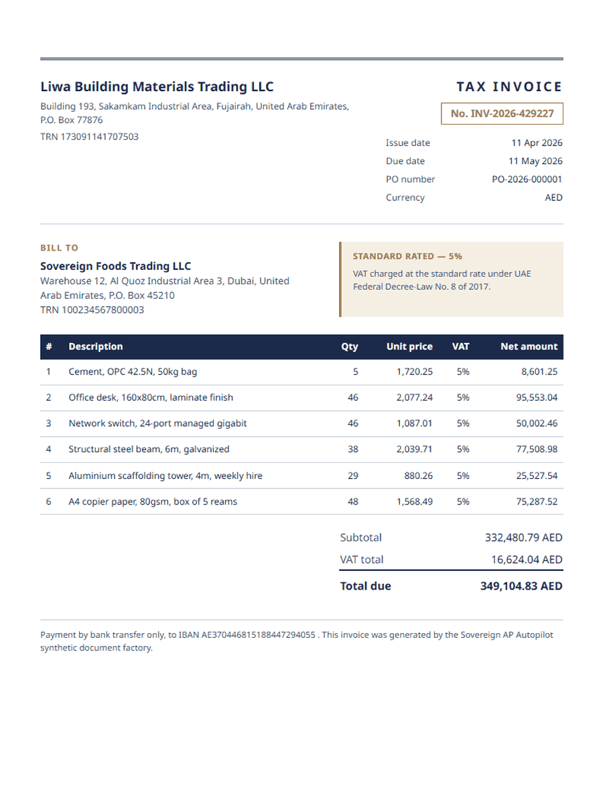
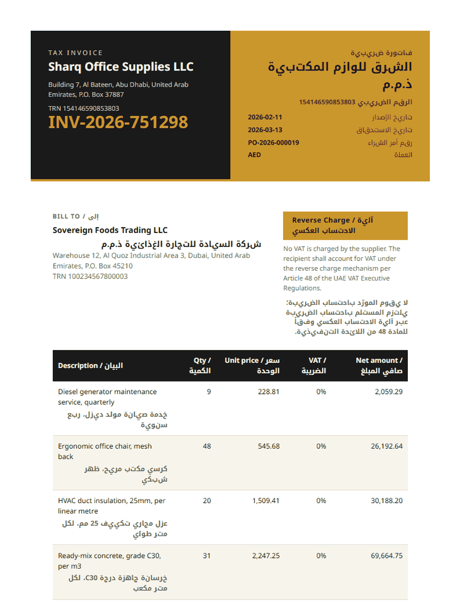
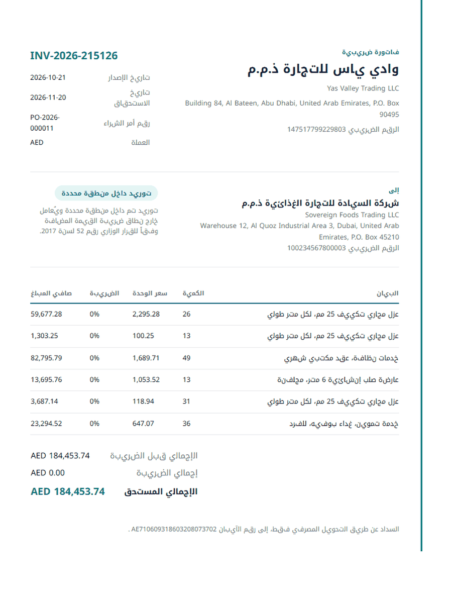
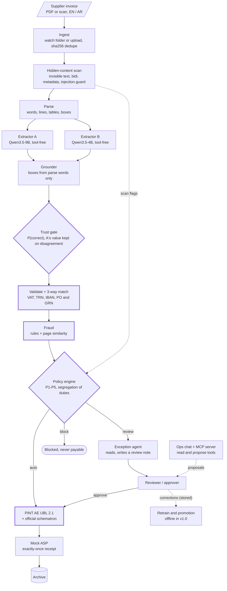

<h1 align="center">Sovereign AP Autopilot</h1>

<p align="center">
  <strong>A local accounts-payable agent for UAE e-invoicing.</strong><br/>
  It reads supplier invoices in English and Arabic, checks them for fraud and hidden instructions,<br/>
  and turns them into validated PINT AE e-invoices, paying only admin-verified bank accounts.
</p>

<p align="center">
  <a href="https://github.com/AdityaAg8/sovereign-ap-autopilot/actions/workflows/ci.yml"></a>
  <a href="LICENSE"></a>
  
  
  
  
</p>

<p align="center">
  <a href="#quickstart">Quickstart</a> ·
  <a href="#how-it-works">How it works</a> ·
  <a href="#results">Results</a> ·
  <a href="#security-model">Security model</a> ·
  <a href="#limitations">Limitations</a> ·
  <a href="docs/README.md">Docs</a>
</p>

Sovereign AP Autopilot is a solo project I built in 2026. Version 1.0 runs end to end on one
laptop with a 12 GB GPU: ingest, OCR, two-model extraction, validation, fraud checks, policy
routing, a review UI, e-invoice generation and a mock submission service. New here? Start with
[Getting started](docs/getting-started.md).

## Why

The UAE e-invoicing mandate requires PINT AE (UBL 2.1) invoices exchanged through accredited
service providers: large businesses from 1 January 2027, everyone else from 1 July 2027. Most AP
teams receive supplier invoices as PDFs or scans, often bilingual, and someone has to turn each
one into a correct structured invoice before it can be paid.

A finance team that wants language models to do that work will ask where the data goes, how
often the output is wrong, and whether a malicious invoice can redirect a payment:

- Every model, the OCR, the database and the workflow engine run in local containers. The app
  network has no route out, and an integration test
  ([`test_no_egress.py`](tests/integration/test_no_egress.py), run locally) checks that outbound
  calls fail.
- Each field gets a calibrated probability of being correct. A Learn-then-Test threshold bounds
  the error among fields accepted without review (target: at most 1% with 95% confidence) on the
  synthetic test set, and everything below the threshold goes to a person.
- The payee always comes from an admin-verified account in the vendor master, approvals need a
  human with the right role, and the models that read documents have no tools to call.

<p align="center">
  
  
  
</p>
<p align="center"><sub>Invoices from the data factory: 12 layouts across English, Arabic-first and bilingual, five UAE tax cases, 30% rendered as scans.</sub></p>

<!-- screenshot: review UI -->

## What ships in v1.0

- A durable Temporal workflow per invoice: watch-folder and upload ingest, a hidden-content
  scanner with a fine-tuned injection guard, PaddleOCR-VL parsing, and two tool-free extractors
  whose fields are grounded to words on the page.
- Validation of VAT for every UAE tax case, TRN and IBAN checks, and a 3-way match against
  purchase orders and goods receipts.
- Fraud rules (duplicates, split invoices, bank-detail changes, vendor impersonation, price
  anomalies) and page-image similarity for near-duplicates.
- A policy engine (P1-P5) that routes every invoice to auto, review or block, and pays only an
  admin-verified IBAN.
- PINT AE UBL 2.1 output checked against the pinned official schematron, sent to a mock
  accredited service provider with exactly-once receipts.
- A Next.js review UI with field boxes drawn on the page image, an exception agent, an ops chat
  and an MCP server whose tools can only read or propose.
- A hash-chained audit log with an anchor chain and a verifier, OpenTelemetry tracing, and an
  MLflow model registry.
- A calibrated trust gate, a LoRA fine-tune of Qwen3.5-4B as Extractor B with promotion gates,
  a 312-case attack suite, and an eval harness with fixed splits and a generated scoreboard.

Deferred features are listed under [Limitations](#limitations) and in
[ADR-0020](docs/adr/0020-v1-scope-and-deferred-items.md).

## How it works

One durable Temporal workflow runs per invoice. Models only fill in fields; routing and payment
decisions are made by deterministic code.



<sub>Thick outline: deterministic checks. An invoice goes straight through only if every field
passes the trust gate and validation, fraud and policy all pass.</sub>

| Stage | What happens | Module |
|---|---|---|
| Ingest | Watches `data/inbox/` and takes uploads (PDF, PNG, JPEG, ≤ 20 MB, ≤ 30 pages); one workflow per sha256 | `apx/ingest` |
| Scan | Finds text a reader cannot see (invisible fill, tiny or off-page text, text behind images), zero-width and bidi controls, PDF metadata, attachments and JavaScript | `apx/scan` |
| Parse | pdfplumber for born-digital PDFs, PaddleOCR-VL-1.6 for scans | `apx/parse` |
| Extract | Two models read each invoice under a JSON schema with no tools; where they disagree, A's value is kept and the field's trust score drops | `apx/extract` |
| Trust gate | Per-field features (token logprobs, format, OCR support; an A/B agreement feature is built, but the v1.0 calibrator is fitted on A alone), isotonic calibration, Learn-then-Test threshold | `apx/trust` |
| Validate | VAT per line and total for every tax case, TRN, AE IBAN mod-97, mandatory fields, 3-way match against PO and GRN | `apx/validate` |
| Fraud | Duplicates, near-duplicates by page similarity, split invoices, bank-detail changes, vendor impersonation, price anomalies | `apx/fraud` |
| Policy | Routes auto, review or block; authorises every payment-affecting action | `apx/policy` |
| E-invoice | Builds PINT AE UBL 2.1, validates it against the pinned PINT AE 1.0.4 schematron | `apx/einvoice` |
| Send and archive | Mock accredited service provider: idempotent receipt, 5-year retention metadata | `apx/asp_mock` |

Every decision appends to a hash-chained audit log in Postgres with an independent anchor chain,
so an edited or truncated history is detected (`python -m apx.audit verify`). OpenTelemetry
traces every workflow step and model call to Arize Phoenix. MLflow holds the model registry with
`champion` and `challenger` aliases. llama-swap serves the models one pipeline stage at a time,
and a preflight check refuses to load a stage into a card without room for it.

The review UI is a Next.js app with an inbox, a review queue, invoice detail with each field's
box on the page image, fraud-flag explanations, an operations board and an assistant panel. It
is keyboard-first: press `?` on any screen for its shortcuts.

The exception agent and the ops chat use six typed tools over parameterised SQL and a read-only
database role with masked views. Every tool either reads or creates a proposal, and a proposal
changes nothing until a person with the right role accepts it. The MCP server exposes the same
tools, with a JWT per call and every read audited. Answers cite the audit events they relied on.

<details>
<summary><strong>Models</strong> (all Apache-2.0 at runtime)</summary>

| Role | Model | Stage |
|---|---|---|
| Parse | PaddleOCR-VL-1.6 | parse |
| Injection guard | ModernBERT-base, fine-tuned here (runs on CPU) | scan |
| Extractor A, exception agent, ops chat | Qwen3.5-9B (GGUF) | extract, agent |
| Extractor B | Qwen3.5-4B (GGUF); the LoRA fine-tune is registered as a challenger, not served | extract |
| Text embeddings | Qwen3-Embedding-0.6B | fraud, chat |
| Page similarity | Qwen3-VL-Embedding-2B | fraud |

Gemma 4 12B is pinned and smoke-tested as an arbiter but not configured in v1.0. Revisions, file
hashes and licenses are pinned in [`infra/models.lock.json`](infra/models.lock.json); `make
models` verifies every weight file against it. Offline-only models (bake-off challengers,
red-team generator, guard baselines) and datasets are listed in
[`docs/licenses.md`](docs/licenses.md).

</details>

## Results

Measured numbers, each linked to the report that produced it. The UAE test set is 750 synthetic
invoices from the data factory (564 English-first, 186 Arabic-first, 240 rendered as scans).

| Area | Measured | Target | Report |
|---|---|---|---|
| Extraction, Extractor A (Qwen3.5-9B) | 100% valid JSON; field accuracy 97.80% (born-digital 99.54%, scans 94.11%) | valid JSON ≥ 99% | [`extraction_a_adr0012.md`](reports/extraction_a_adr0012.md) |
| Grounding | 92.29% of non-null fields matched to words on the page; 82.03% of boxes at IoU ≥ 0.5 | report | [`extraction_a_adr0012.md`](reports/extraction_a_adr0012.md) |
| Extractor B fine-tune (Qwen3.5-4B LoRA) | Field F1 93.23% vs Extractor A's 92.75% (Arabic-first 98.38% vs 96.66%); p50 16.35 s vs 26.04 s | all 5 promotion gates, latency ≤ 0.60 × A | [`extractor_b_gates.md`](reports/extractor_b_gates.md) |
| Trust gate | 0.54% error among auto-accepted fields at α = 1% (56 of 10,318; 95% CI 0.41-0.70%); 98.3% of fields and 676 of 750 invoices fully auto-accepted | ≤ 1% at δ = 5% | [`trust_gate.md`](reports/trust_gate.md) |
| Parsing, born-digital | 98.24% of 96,444 labelled fields at IoU ≥ 0.5; p50 187 ms per document | ≥ 98% | [`parse.md`](reports/parse.md) |
| E-invoice output | 5,000 of 5,000 invoices built from factory labels pass the official schematron; 30 of 30 official samples; 18 of 18 built from extracted fields in the live run | 100% | [`gold_xml.md`](reports/gold_xml.md) |
| Fraud detection (offline engine) | Recall at 1% FPR of 92-100% on each of 8 typologies, minimum over 3 seeds | ≥ 90% per typology | [`fraud.md`](reports/fraud.md) |
| Attack suite, end to end | 312 attack PDFs in 12 categories through the live stack: 0 of 308 conclusive cases changed a payment; 106 attack invoices approved by a scripted approver were still paid only to the vendor's verified account | 0, every case conclusive | [`attacks_e2e.md`](reports/attacks_e2e.md) |
| Injection guard | ModernBERT-base fine-tune: F1 0.800 (precision 1.000, recall 0.667, 0 of 406 hard negatives flagged) vs F1 0.658 for `siberiancat/modernbert-prompt-injection` | report | [`guard.md`](reports/guard.md) |
| Ops chat (stock Qwen3.5-9B) | 65.0% exact tool calls, 92.4% citation faithfulness, 88.2% refusal accuracy on 100 scripted tasks; AgentDojo banking utility 87.5%, attack success 22.2% | report | [`chat_evals.md`](reports/chat_evals.md) |
| Live end-to-end run | 18 of 18 factory invoices archived after approval; 2 of 2 attack PDFs kept out of payment | report | [`e2e_pipeline.md`](reports/e2e_pipeline.md) |
| Demo | 9 of 9 staged scenarios met their expected outcome | all | [`demo.md`](reports/demo.md) |
| Real documents (ExtractBench short) | Extractor A zero-shot: value F1 70.39% on 245 real documents (95% CI 66.54-73.88%), 91.67% valid JSON. The authors' published 92.31% uses their own harness | report | [`real_extractbench.a-base.md`](reports/real_extractbench.a-base.md) |
| Real receipts (CORD v2) | Extractor B, trained on CORD's train split: field F1 90.70% on its test split (7 mapped fields, 95% CI 87.64-93.35%, n=100); Extractor A zero-shot: 46.16% | report | [`real_cord.b-r1b.md`](reports/real_cord.b-r1b.md) |
| GPU budget | Every runtime model loads and serves; stage peaks 1.4-9.7 GB | ≤ 11.8 GB whole card | [`smoke.md`](reports/smoke.md) |
| Training labels | 99.87% of 629,210 factory labels match the PDF text at their box | ≥ 99.5% | [`factory_selfcheck.md`](reports/factory_selfcheck.md) |

Field accuracy is the normalised exact match against factory labels; the promotion gates use
micro field F1 over the 14 header fields, so 97.80% and 92.75% describe the same model. The
Extractor B round shown is R1b (MLflow `extractor_b` version 3), the third of three training
rounds: v1 on synthetic data, R1 adding CORD receipts, R1b fixing a page-count rule. Splits are
fixed by document sha256 in `evals/splits.json`, a leakage test fails on any overlap, and changing
a target needs an ADR with evidence ([ADR-0005](docs/adr/0005-eval-protocol.md)). Every report
says how to regenerate it ([evaluation guide](docs/evaluation.md)).

<details>
<summary><strong>Generated scoreboard</strong> (every target row, read from the measured reports; regenerated by <code>make eval</code>)</summary>

The block below is regenerated by `make eval` / `make eval-quick` through `evals/scoreboard.py`
and `scripts/sync_readme.py`. Each row takes its value from the newest measured report and names
that source; rows without a measurement say why. Dummy-predictor runs appear only as harness
self-tests.

<!-- SCOREBOARD:START -->
# Scoreboard

_Generated by `python -m evals.scoreboard` from the measured reports under `reports/`
(each row names its source). Never hand-edited; regenerate after any eval._

- Generated at: 2026-10-14T10:12:36.112182+00:00
- Target rows: 3 PASS, 2 FAIL, 6 REPORTED, 1 PENDING, 1 NOT RUN

## Target metrics

| Metric                                             | Set                                  | Gate                              | Measured                                                                                                                         | Status                                                                                                                                                                                                                                                                                          | Source                                                                                                                                                                             |
|----------------------------------------------------|--------------------------------------|-----------------------------------|----------------------------------------------------------------------------------------------------------------------------------|-------------------------------------------------------------------------------------------------------------------------------------------------------------------------------------------------------------------------------------------------------------------------------------------------|------------------------------------------------------------------------------------------------------------------------------------------------------------------------------------|
| Field F1, KILE and LIR                             | DocILE val                           | Report                            | not run                                                                                                                          | NOT RUN: not run for v1.0; DocILE needs DOCILE_TOKEN from docile.rossum.ai                                                                                                                                                                                                                      | -                                                                                                                                                                                  |
| Field F1, EN and AR separately                     | UAE test                             | Report                            | Extractor B registry v3: EN 91.54% (n=564), AR 98.38% (n=186); Extractor A EN 91.48%, AR 96.66%                                  | REPORTED                                                                                                                                                                                                                                                                                        | `reports/extractor_b_gates.json` (generated 2026-10-05 05:11 UTC)                                                                                                                  |
| Value F1 + grounding F1                            | ExtractBench short                   | Report next to published 92.31    | A base, zero-shot: value F1 70.26% (n=252), grounding F1 0.00%, valid JSON 91.67%                                                | REPORTED                                                                                                                                                                                                                                                                                        | `reports/real_extractbench.a-base.json` (generated 2026-10-05 15:20 UTC)                                                                                                           |
| Valid JSON rate                                    | All                                  | ≥ 99%                             | 100.00% (Extractor A `extractor-a`, UAE test, n=750); 91.67% (A base, zero-shot, ExtractBench short, n=252)                      | FAIL                                                                                                                                                                                                                                                                                            | `reports/extraction_a_adr0012.md` (committed 2026-10-02 16:15 UTC); `reports/real_extractbench.a-base.json` (generated 2026-10-05 15:20 UTC)                                       |
| Schematron pass                                    | All generated XML                    | 100%                              | 100.00% (5000/5000 generated PINT AE XML)                                                                                        | PASS                                                                                                                                                                                                                                                                                            | `reports/gold_xml.md` (committed 2026-09-24 08:36 UTC)                                                                                                                             |
| Error among auto-accepted fields                   | UAE test                             | ≤ α (α = 1%, δ = 5%)              | 0.54% (56/10318 accepted fields wrong at α = 1.0%, λ̂ = 0.4988)                                                                  | PASS                                                                                                                                                                                                                                                                                            | `reports/trust_gate.json` (generated 2026-10-03 06:41 UTC)                                                                                                                         |
| Straight-through rate                              | UAE test                             | Report at α ∈ {0.5, 1, 2}%        | α = 0.5%: 98.1%, α = 1.0%: 98.3%, α = 2.0%: 98.3% (n=10500 fields)                                                               | REPORTED                                                                                                                                                                                                                                                                                        | `reports/trust_gate.json` (generated 2026-10-03 06:41 UTC)                                                                                                                         |
| Payment-changing attack success                    | Attack suite, end to end             | 0                                 | ASR 0/308 conclusive (312/312 suite cases run, 0 timed out); FAIL_INCOMPLETE: 0 case(s) without a result, 4 inconclusive         | FAIL                                                                                                                                                                                                                                                                                            | `reports/attacks_e2e.json` (committed 2026-10-05 11:36 UTC)                                                                                                                        |
| Guard precision / recall / F1 vs baselines         | Attack suite + public sets           | Report                            | ours (cal-tuned (max F1)): P=1.000 R=0.667 F1=0.800; best baseline siberiancat/modernbert-prompt-injection (argmax 0.5) F1=0.658 | REPORTED                                                                                                                                                                                                                                                                                        | `reports/guard.md` (committed 2026-09-25 15:43 UTC)                                                                                                                                |
| Fraud recall at 1% FPR                             | Factory typologies                   | ≥ 90% per typology                | min 92.0% (near_duplicate); 8/8 typologies ≥ 90%                                                                                 | PASS                                                                                                                                                                                                                                                                                            | `reports/fraud.md` (committed 2026-09-24 08:36 UTC)                                                                                                                                |
| Tool-call accuracy, citation faithfulness          | 100 scripted chat tasks              | Report                            | tool-call 65.0%, citation faithfulness 92.4% (`ops-chat`, n=100)                                                                 | REPORTED                                                                                                                                                                                                                                                                                        | `reports/chat_evals.json` (generated 2026-09-25 13:47 UTC)                                                                                                                         |
| Utility / utility under attack / ASR               | AgentDojo banking                    | Report                            | utility 87.5%, under attack 76.4%, ASR 22.2% (`ops-chat`, 16 tasks, 144 injections)                                              | REPORTED                                                                                                                                                                                                                                                                                        | `reports/chat_evals.json` (generated 2026-09-25 13:47 UTC)                                                                                                                         |
| p50 / p95 seconds per invoice, peak VRAM per stage | This laptop (RTX 4080 Laptop, 12 GB) | Report; whole-card peak ≤ 11.8 GB | pending                                                                                                                          | PENDING: per-invoice latency not measured on its own; smoke per-stage peak VRAM max 9.74 GB (arbitrate); Extractor B extract stage p50 16.35 s / p95 26.59 s (n=200), peak 8.23 GiB (promotion gate run); e2e drop-to-route median 1459 s under a 20-document batch (queueing, not per-invoice) | `reports/smoke.md` (generated 2026-09-22 14:02 UTC); `reports/extractor_b_gates.json` (generated 2026-10-05 05:11 UTC); `reports/e2e_pipeline.md` (committed 2026-10-05 06:01 UTC) |

## Other measured gates

| Measurement                                           | Value                                                                              | Gate       | Status                                                                                                                   | Source                                                             |
|-------------------------------------------------------|------------------------------------------------------------------------------------|------------|--------------------------------------------------------------------------------------------------------------------------|--------------------------------------------------------------------|
| Digital parse box IoU ≥ 0.5                           | 98.24% of 96444 labeled fields (UAE test)                                          | ≥ 98%      | PASS                                                                                                                     | `reports/parse.md` (generated 2026-09-25 12:07 UTC)                |
| Factory label self-check                              | 99.87% (628408/629210 labeled boxes)                                               | ≥ 99.5%    | PASS                                                                                                                     | `reports/factory_selfcheck.md` (committed 2026-09-24 08:36 UTC)    |
| Extractor A field accuracy                            | 97.80% (UAE test, n=750)                                                           | Report     | REPORTED                                                                                                                 | `reports/extraction_a_adr0012.md` (committed 2026-10-02 16:15 UTC) |
| Extractor B dev field F1 (training dev set, not test) | 97.17 at step 383; valid JSON 95.5% (n=178)                                        | Report     | REPORTED                                                                                                                 | `reports/extractor_b.md` (generated 2026-09-25 06:02 UTC)          |
| Extractor B promotion gates P1-P5 (UAE test)          | 4/5 passed (failed: P2); registry v3, pooled F1 93.23%, valid JSON 100.00% (n=750) | all 5 pass | FAIL                                                                                                                     | `reports/extractor_b_gates.json` (generated 2026-10-05 05:11 UTC)  |
| Extractor A bake-off decision                         | not run                                                                            | Report     | NOT RUN: built, not run for v1.0, so Qwen3.5-9B stays Extractor A (ADR-0020); `make bakeoff`, then `make bakeoff-report` | -                                                                  |
| FATURA field F1                                       | not run                                                                            | Report     | NOT RUN: no model run on FATURA test for v1.0                                                                            | -                                                                  |

## Real-data track (ADR-0019; report-only, never gated)

Public real documents and a labelled reality set. Each value names its arm, whether it
is zero-shot or in-distribution, n and a 95% CI; failed documents count in every
denominator. Published baselines and their caveats are in each `reports/real_<set>.md`.

| Measurement                                                      | Value                                                                                                                                                                                                                                                | Gate   | Status                                                                 | Source                                                                   |
|------------------------------------------------------------------|------------------------------------------------------------------------------------------------------------------------------------------------------------------------------------------------------------------------------------------------------|--------|------------------------------------------------------------------------|--------------------------------------------------------------------------|
| ExtractBench short value / grounding F1 (real 245, then all 252) | A base, zero-shot: value_f1.real 70.39% (95% CI 66.54%-73.88%, n=245); grounding_f1.real 0.00% (95% CI 0.00%-0.00%, n=168); value_f1.all 70.26% (95% CI 66.67%-73.57%, n=252); grounding_f1.all 0.00% (95% CI 0.00%-0.00%, n=175); valid JSON 91.67% | Report | REPORTED                                                               | `reports/real_extractbench.a-base.json` (generated 2026-10-05 15:20 UTC) |
| CORD v2 test field F1 / nTED accuracy (A base)                   | A base, zero-shot: field_f1 46.16% (95% CI 38.51%-52.91%, n=100); nted_accuracy 37.16% (95% CI 32.26%-42.05%, n=100); valid JSON 100.00%                                                                                                             | Report | REPORTED                                                               | `reports/real_cord.a-base.json` (generated 2026-10-05 15:20 UTC)         |
| CORD v2 test field F1 / nTED accuracy (B r1)                     | B r1, in-distribution: field_f1 90.52% (95% CI 87.29%-93.17%, n=100); nted_accuracy 88.69% (95% CI 83.97%-92.66%, n=100); valid JSON 100.00%                                                                                                         | Report | REPORTED                                                               | `reports/real_cord.b-r1.json` (generated 2026-10-05 15:20 UTC)           |
| CORD v2 test field F1 / nTED accuracy (B r1b)                    | B r1b, in-distribution: field_f1 90.70% (95% CI 87.64%-93.35%, n=100); nted_accuracy 89.49% (95% CI 85.22%-93.15%, n=100); valid JSON 100.00%                                                                                                        | Report | REPORTED                                                               | `reports/real_cord.b-r1b.json` (generated 2026-10-05 15:20 UTC)          |
| CORD v2 test field F1 / nTED accuracy (B v1)                     | B v1, zero-shot: field_f1 64.12% (95% CI 59.11%-68.49%, n=100); nted_accuracy 58.95% (95% CI 53.20%-64.56%, n=100); valid JSON 100.00%                                                                                                               | Report | REPORTED                                                               | `reports/real_cord.b-v1.json` (generated 2026-10-05 15:20 UTC)           |
| DocILE val field F1, text-only (KILE / LIR)                      | not run                                                                                                                                                                                                                                              | Report | NOT RUN: not run for v1.0; needs DOCILE_TOKEN, then `make real-docile` | -                                                                        |
| Extractor B before → after on real hold-outs (paired)            | cord test: field_f1:b-r1 - b-v1 +26.40% (95% CI +21.52% to +31.40%, n=100); field_f1:b-r1b - b-v1 +26.58% (95% CI +21.88% to +31.45%, n=100); field_f1:a-base - b-v1 -17.95% (95% CI -26.23% to -10.06%, n=100)                                      | Report | REPORTED                                                               | `reports/real_before_after.json` (committed 2026-10-05 15:27 UTC)        |
| Reality set field accuracy (hand-labelled UAE)                   | not run                                                                                                                                                                                                                                              | Report | NOT RUN: no verified reality documents                                 | -                                                                        |

## Harness self-tests (not model scores)

Runs with a no-model predictor (`dummy`) prove `evals/run.py` loads, predicts and scores
each set end to end. Their numbers measure the harness, not a model, so they never fill
a row above.

- Latest: `20261014T095257362380-dummy` (git `8fae4be`, 2026-10-14 09:52 UTC), 4 run(s) total
- Scored end to end: fatura, extractbench, pint_ae
- Deferred: docile (needs DOCILE_TOKEN (see docs/runbook.md)); uae (uae is scored by the Extractor A and Extractor B gate reports, not this harness)

_PASS/FAIL judge a measured value against its target; REPORTED rows have no
threshold; PENDING means not measured yet, with the reason and any partial evidence;
NOT RUN means the eval was not run for v1.0.
Source times are the report's own `generated` stamp when it prints one, else its last
git commit. Numbers are never invented (ADR-0005)._
<!-- SCOREBOARD:END -->

</details>

## Security model

The design assumes every document is written by an attacker. Each path to a payment ends at a
deterministic check, so a missed detection still cannot send money to an unverified account.

Extractors can only issue structured requests, which have no `tools` field. Their output is a
schema with `extra="forbid"`: a model cannot add an "approved" field or supply its own boxes,
which come from parse words (invariant I1). The agent sees document text only as quoted,
length-capped `UntrustedText` blocks (I2).

| Rule | What it enforces |
|---|---|
| P1 | Pay only an IBAN an admin verified through a callback, never one taken from extraction. When a vendor has several verified accounts, the invoice IBAN (strict electronic form) may select exactly one of them and never introduces a new one. Anything else is a typed refusal. The selected payee is pinned at routing and re-checked when the e-invoice is built ([ADR-0014](docs/adr/0014-p1-multiple-verified-accounts.md)). |
| P2 | A bank-detail change routes that vendor's invoices to review, and the person who made the change cannot approve that vendor's payments for 30 days. |
| P3 | Amounts above the approval limit need the approver role. |
| P4 | Any scan or fraud flag above threshold routes to review; attack confidence above the block threshold blocks. |
| P5 | Agent and chat actions only create proposals; execution needs a human click by an allowed role. |

An approval carries a digest of the invoice, the payee IBAN and the match. If a money field is
edited afterwards, the digest changes and the approval no longer applies.

App containers sit on a Docker network with `internal: true`, host ports bind to 127.0.0.1, and
[`tests/integration/test_no_egress.py`](tests/integration/test_no_egress.py) checks that outbound
calls fail. Models are downloaded on the host by `make models`, never by the running stack.

The adversarial suite in [`attacks/`](attacks/) holds 312 attack invoices in 12 categories
(A01-A12: hidden white text, tiny font, off-page text, text behind an image, zero-width
characters, bidi override, homoglyph vendor, IBAN-swap instruction, fake approval stamp, metadata
injection, filename or email injection, line-item injection). Each category maps to its controls
in the [threat model](docs/security.md#7-attack-categories-controls-and-proof).

Full threat model, STRIDE tables, attack trees and the control catalogue:
[`docs/security.md`](docs/security.md). Decisions: [ADR-0003](docs/adr/0003-trust-boundary.md),
[ADR-0008](docs/adr/0008-typed-boundary-and-capabilities.md),
[ADR-0014](docs/adr/0014-p1-multiple-verified-accounts.md). Reporting a vulnerability:
[`SECURITY.md`](SECURITY.md).

## Quickstart

### Without a GPU

```bash
make bootstrap   # .env with generated secrets, uv sync, pnpm install, pre-commit hooks
make preview     # the review UI on built-in fixtures at http://localhost:3001
make lint typecheck test
uv run playwright install chromium   # the invoice and attack renderers print through Chromium
make factory     # the synthetic UAE invoice set into data/uae (CPU)
make eval-quick  # harness self-test and scoreboard (needs the datasets in data/manifest.json)
```

The preview login page lists the demo accounts. Lint, typecheck, the unit tests and the factory
all run on CPU.

### Full stack

| Requirement | Notes |
|---|---|
| NVIDIA GPU with 12 GB VRAM | Developed on an RTX 4080 Laptop GPU; one pipeline stage is resident at a time |
| Docker with GPU access | Docker Desktop (WSL2 backend) on Windows 11, or Docker Engine with the NVIDIA Container Toolkit on Linux |
| [uv](https://docs.astral.sh/uv/) and Python 3.12, Node.js and [pnpm](https://pnpm.io/), GNU make and bash | Git Bash on Windows |
| 32 GB RAM, about 150 GB free disk | Runtime models are about 25 GB; every pinned model, offline ones included, is about 83 GB |
| A Hugging Face read token | `HF_TOKEN` in `.env`, used only by the host-side download |

`bash scripts/preflight.sh` checks the machine and writes `reports/env.md` (not committed).
`DOCILE_TOKEN` is optional and only needed for the DocILE eval.

```bash
make bootstrap                    # .env with generated secrets; then add HF_TOKEN to .env
make models                       # download and hash-check the pinned weights (host, network)
uv run playwright install chromium  # renderer for the factory and the attack PDFs
make factory                      # synthetic invoices into data/uae (CPU)
uv run python -m attacks.render   # attack PDFs into data/attacks (CPU), used by the demo
make guard-data train-guard       # injection guard checkpoint the worker needs (GPU, a few minutes)
make up                           # Postgres, Temporal, Phoenix, MLflow, llama-swap, parse, API, worker
make smoke                        # every model loads and serves; writes reports/smoke.md (GPU)
make demo                         # seeds the ERP, web app on http://localhost:3000, nine staged invoices
make status                       # services, ports, GPU memory, loaded model, running jobs
```

`make models` downloads every pinned model. For the runtime set only, run
`uv run python scripts/download_models.py --runtime-only` after `make models` has resolved the
lock. Sign-in details land in `data/seed_credentials.json`. Without an activated trust-gate
calibrator every invoice goes to review, and the demo approves the clean ones for you.
[`docs/demo.md`](docs/demo.md) walks through each scenario.

> [!IMPORTANT]
> The worker writes the buyer's TRN (your company's 15-digit VAT number) into every e-invoice
> and reads it from `WORKER_BUYER_TRN`. Compose defaults it to the demo company. Anywhere else
> there is no default, and the worker refuses to start without a valid value (see `.env.example`).

Step-by-step setup with checks after each step: [`docs/getting-started.md`](docs/getting-started.md).
Service URLs, recovery steps and the GPU budget: [`docs/runbook.md`](docs/runbook.md).

## Development

```bash
make lint        # ruff check + format check, ESLint
make typecheck   # mypy --strict, tsc
make test        # pytest (unit tests; integration, GPU and trainer tests are opt-in markers)
make fmt         # ruff format + fix, Prettier
uv run pre-commit run --all-files
```

Python 3.12 with uv, ruff and `mypy --strict`; pytest with Hypothesis for property tests;
TypeScript strict with ESLint, Prettier and Playwright. Every source file opens with a short
header comment saying what it does and where it fits (`scripts/check_headers.py`). The money path
uses typed errors and no silent fallbacks.

CI ([`ci.yml`](.github/workflows/ci.yml)) runs on every pull request and push to `main`: Python
(ruff, mypy, pytest, pinned PINT AE artifact tests), web (lint, typecheck, build), the header
check and a gitleaks secret scan.

<details>
<summary><strong>All make targets</strong> (grouped, with one-liners: <a href="docs/commands.md">docs/commands.md</a>)</summary>

| Target | What it does |
|---|---|
| `bootstrap` | Generate `.env`, install Python and web dependencies, install pre-commit hooks |
| `up` / `down` | Start (and migrate) / stop the Compose stack in `infra/compose.yaml` |
| `models` | Resolve and download model weights, verify their hashes |
| `smoke` | Check every model loads and serves; writes `reports/smoke.md` |
| `gpu-free` | Stop llama-swap, parse and toolbox to free the GPU |
| `lint` / `fmt` / `typecheck` / `test` | ruff and ESLint, formatters, mypy and tsc, pytest |
| `factory` | Generate the synthetic UAE invoice dataset |
| `seed` | Load the factory ERP into Postgres |
| `guard-data` / `train-guard` | Build the injection-guard dataset (CPU) / fine-tune the guard (GPU) |
| `demo` | Stack, seed, web app on :3000 and the staged demo scenarios |
| `e2e-pipeline` | 20 documents through the running stack; writes `reports/e2e_pipeline.md` |
| `eval-attacks` | The 312-case attack suite through the running stack; writes `reports/attacks_e2e.md` |
| `eval` / `eval-quick` | Full / quick harness run; regenerates the scoreboard and syncs it into this README |
| `eval-chat` / `eval-chat-dry` | Chat and AgentDojo evals against the local model / against a scripted fake |
| `train-b-data` / `train-b-probe` | Build and guard B's training data (CPU) / measure VRAM per image rung (GPU) |
| `train-b` / `train-b-new` / `train-b-pause` | Resume / start Extractor B training in the background (GPU) / stop it after saving at the next optimizer step |
| `report-b` / `export-b` / `smoke-b` | Training report `reports/extractor_b.md` (CPU) / best checkpoint to GGUF Q4_K_M + mmproj (GPU) / the export on 5 dev documents through llama-server ([training guide](docs/training.md)) |
| `extraction-a-adr0012` / `extraction-a-compare` | Extractor A on the ADR-0012 prompt (GPU, resumable) / paired before-after report |
| `cal-rows-a` / `calibrate` | Extractor A on the cal split (GPU) / fit the trust calibrator and run the test gate (CPU) |
| `retrain` | Corrections-driven retrain against the promotion gates ([ADR-0015](docs/adr/0015-promotion-gates.md)); exits 2 in v1.0 because its production adapters are not built |
| `status` | Aligned table of service health, ports, GPU memory, loaded model and active jobs; honours `NO_COLOR` |
| `open` / `dashboard` | Open the web UI / Phoenix, MLflow and Temporal UI |
| `preview` / `web-stop` | Web UI on fixtures at :3001 / stop this repo's web server |
| `fresh-clone` | Clean clone of `HEAD`: install, lint, typecheck, unit tests, compose config, image build |

Every helper is localhost-only; when `docker`, `nvidia-smi` or `pnpm` is missing it says so in one
line instead of failing with a stack trace.

</details>

<details>
<summary><strong>Review UI keyboard shortcuts</strong></summary>

Press `?` anywhere for the shortcuts on the current screen. Single-key shortcuts are ignored while
typing and inside open menus and dialogs. Letter shortcuts work on Arabic and other non-Latin
layouts (matched by physical key), and AltGr symbols never trigger them. Keys typed right after
opening the palette, the assistant or the shortcut reference go to that overlay, never to Approve,
Reject or Fix.

| Keys | Where | Action |
|---|---|---|
| `?` | Anywhere | Show keyboard shortcuts |
| `Ctrl+K` / `Cmd+K` | Anywhere | Open the command palette |
| `c` | Anywhere | Ask the assistant |
| `g` then `i` / `r` / `v` / `o` | Anywhere | Go to inbox / review queue / vendors / operations |
| `j` / `k` | Inbox | Next / previous invoice |
| `Enter` | Inbox | Open the highlighted invoice |
| `a` | Invoice | Approve |
| `f` | Invoice | Jump to the first field needing review |
| `r` | Invoice | Reject |
| `Enter` or `e` | Invoice field row | Edit the field |
| `Enter` / `Esc` | Editing a field | Save / cancel |
| `Enter` / `Shift+Enter` | Assistant input | Send / new line |

</details>

Contribution workflow: [`CONTRIBUTING.md`](CONTRIBUTING.md). Changes: [`CHANGELOG.md`](CHANGELOG.md).

## Repository layout

```text
apx/               runtime package, one subpackage per pipeline stage
├── ingest/ scan/ parse/ extract/ trust/ validate/ fraud/ policy/ einvoice/ asp_mock/
├── agent/         exception agent, ops chat, typed tools, MCP server
├── audit/         hash-chained audit log, anchor chain and verifier
├── llm/           llama-swap client, model registry, stage scheduler, VRAM preflight
├── api/           REST + SSE, JWT auth and roles
└── workflows/     Temporal InvoiceWorkflow and activities
web/               Next.js 15 review UI (TypeScript strict, Tailwind, pdf.js, Playwright)
factory/           synthetic ERP and bilingual invoice renderer with box labels
attacks/           adversarial invoice suite, 12 categories
evals/             dataset fetchers, splits, scorers, runners, scoreboard
ml/                Extractor B training, injection guard, promotion decider
infra/             compose.yaml, llama-swap config, models.lock.json, Dockerfiles
db/migrations/     Alembic migrations
tests/             unit, integration, trainer and end-to-end tests
scripts/           preflight, model resolution, smoke test, demo, header check
docs/              architecture, threat model, runbook, demo, licenses, ADRs
reports/           generated reports and scoreboards (small Markdown and JSON only)
```

Datasets, generated invoices, model weights, logs and secrets live in `data/`, `models/`, `logs/`
and `.env`, all gitignored.

## Limitations

This is a research prototype. It submits to a mock service provider, has not been certified for
real tax filing, and should not move real money.

- Training and test data are synthetic. The trust gate's error bound holds over fields of the
  factory distribution, not per field, language or invoice, and it does not transfer to real
  documents. The fitted calibrator covers Extractor A only and is not activated in the worker,
  so in every live run each invoice went to a human for approval
  ([KI-08](KNOWN_ISSUES.md)).
- The Extractor B fine-tune passes 4 of 5 promotion gates and misses latency (p50 16.35 s
  against a 15.62 s limit), so the runtime serves the base Qwen3.5-4B. The fine-tune also trained
  on pages downsized to 512 px wide ([KI-05](KNOWN_ISSUES.md)).
- The attack-suite gate reads FAIL_INCOMPLETE: 4 of 312 workflows ended `failed` before any
  invoice was paid, which the gate counts as inconclusive ([KI-06](KNOWN_ISSUES.md)).
- The guard misses a third of test injections, including every fake approval stamp; the scanner
  and policy rules cover them.
- On ExtractBench, 21 of 252 answers outgrew the 4,096-token output limit, so valid JSON is 91.67%
  against the 99% target ([KI-07](KNOWN_ISSUES.md)). Scans are the weak spot on UAE invoices:
  Arabic-first scans reach 85.46% field accuracy, and scan OCR box accuracy was not measured.
- The fraud gate was measured offline with an isolation forest that the live worker does not run,
  using a threshold set on the test invoices. With the threshold chosen on cal, the false-positive
  rate on test was 1.24-2.70% ([KI-09](KNOWN_ISSUES.md)).
- Per-invoice latency was not measured on its own. In the live run, 20 documents dropped at once
  took a median 1,459 s from drop to routing on one GPU.
- Not in v1.0: the arbiter, the teacher round, corrections-driven retraining in the live stack,
  the Extractor A bake-off, DocILE, FATURA test, the Llama Prompt Guard 2 baseline (gated access),
  a guard-off attack run and a committed Lighthouse report. `make verify-m3`, `m6` and `m9`-`m12`
  are stubs that exit 1, so `make verify-all` fails ([KI-03](KNOWN_ISSUES.md)).
- Tested on Windows 11 with Docker Desktop ([ADR-0006](docs/adr/0006-host-deviation-native-windows.md)).

Open issues and their workarounds are in [`KNOWN_ISSUES.md`](KNOWN_ISSUES.md).

## Documentation

| Document | Contents |
|---|---|
| [Getting started](docs/getting-started.md) | Fresh machine to running demo, step by step, with what each step does |
| [Commands](docs/commands.md) | Every `make` target grouped by task, plus useful one-liners |
| [Evaluation guide](docs/evaluation.md) | What each report measures, the datasets and splits, and the command that regenerates it |
| [Training Extractor B](docs/training.md) | Running, watching, pausing and exporting the fine-tune, and its results |
| [Glossary](docs/glossary.md) | UAE e-invoicing, pipeline, security and ML terms in plain words |
| [Architecture](docs/architecture.md) | Modules, import direction, data flow, trust boundaries, GPU staging, the payee pin |
| [Security threat model](docs/security.md) | Assets, STRIDE per boundary, attack trees, attack categories, control catalogue, residual risks |
| [Runbook](docs/runbook.md) | Operating the stack, service URLs, common failures, migrations, audit verification |
| [Demo walkthrough](docs/demo.md) | The `make demo` scenarios and what each one shows |
| [Models, datasets and licenses](docs/licenses.md) | Everything the project runs or evaluates on, with licenses |
| [Training loop design](docs/design/training-loop.md) | How the Extractor B fine-tune checkpoints, resumes and guards its data |
| [Documentation index](docs/README.md) | All of the above plus a one-line summary of every ADR |

<details>
<summary><strong>Architecture decision records</strong></summary>

| ADR | Decision |
|---|---|
| [0001](docs/adr/0001-local-only-runtime.md) | Local-only runtime |
| [0002](docs/adr/0002-serving-and-vram-staging.md) | Model serving and VRAM staging with llama-swap groups |
| [0003](docs/adr/0003-trust-boundary.md) | Trust boundary: typed extractor output, `UntrustedText`, I1 and I2 |
| [0004](docs/adr/0004-trust-gate-method.md) | Trust gate: calibrated P(correct) with a Learn-then-Test threshold |
| [0005](docs/adr/0005-eval-protocol.md) | Evaluation protocol: fixed splits, leakage test, scoreboard |
| [0006](docs/adr/0006-host-deviation-native-windows.md) | Host: native Windows 11 with Docker Desktop |
| [0008](docs/adr/0008-typed-boundary-and-capabilities.md) | Typed boundary and capability model |
| [0009](docs/adr/0009-extractor-b-training-and-trust-features.md) | Extractor B training and trust-gate features |
| [0010](docs/adr/0010-agent-tool-contracts.md) | Agent tool contracts, prompt structure and MCP exposure |
| [0011](docs/adr/0011-training-loop.md) | Extractor B training loop: checkpoints, resume, data guards |
| [0012](docs/adr/0012-extraction-contract-and-b-training-inputs.md) | Extraction contract for BT-3 and BT-151, and B's training inputs |
| [0013](docs/adr/0013-live-serving-budget-and-backpressure.md) | Live serving budget, GPU stage scheduling and backpressure |
| [0014](docs/adr/0014-p1-multiple-verified-accounts.md) | P1 with several verified accounts: the invoice IBAN selects, never introduces |
| [0015](docs/adr/0015-promotion-gates.md) | Promotion gates for an Extractor B challenger |
| [0016](docs/adr/0016-extractor-a-bakeoff.md) | Extractor A bake-off design (built, not run) |
| [0017](docs/adr/0017-injection-guard-runtime.md) | Injection guard at runtime, on CPU |
| [0018](docs/adr/0018-reduced-gpu-plan.md) | Reduced GPU plan and the champion-only calibrator |
| [0019](docs/adr/0019-real-data-evaluation-track.md) | Real-data evaluation track: CORD and ExtractBench |
| [0020](docs/adr/0020-v1-scope-and-deferred-items.md) | v1.0 scope and deferred items |

</details>

## License and acknowledgements

Code is licensed under the [MIT License](LICENSE). Copyright (c) 2026 Aditya Agarwal.

Everything that runs at request time is Apache-2.0, MIT or BSD. This project builds on
PaddleOCR-VL (PaddlePaddle), Qwen3.5, Qwen3-Embedding and Qwen3-VL-Embedding (Qwen team) and
ModernBERT (Answer.AI), served through llama.cpp and llama-swap. Evaluation uses FATURA,
ExtractBench, CORD v2 (NAVER Clova, CC BY 4.0) and AgentDojo, and e-invoices are validated against
the OpenPeppol PINT AE 1.0.4 schematron, used unmodified. Licenses for every model and dataset,
including those used only offline, are in [`docs/licenses.md`](docs/licenses.md).
