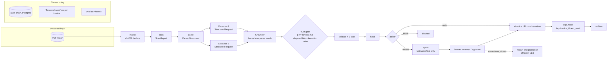

# Architecture

Sovereign AP Autopilot turns supplier invoices (PDF or scan, EN/AR) into validated UAE PINT AE
e-invoices on one 12 GB laptop GPU, with no outbound network at runtime. Decisions are in `docs/adr/` (index at the end of this
file).

## Components

| Module | Interface file | Responsibility |
|---|---|---|
| `apx/common` | `types.py`, `untrusted.py`, `errors.py`, `invoice.py`, `master.py`, `purchasing.py` | Shared value types (`BBox`, `FieldValue`, `Money`, `IdempotencyKey`), `UntrustedText`, typed errors, canonical `Invoice`, vendor master and users, `PurchaseOrder`/`PoLine` (needed by both `validate` and `fraud`) and `attribute_po_line`: an invoice line bills a PO line only by a PO line ref stated on the document, else by a unique normalized description + exact quantity; never by position (the extraction schema has no line ref, so the builder sets none) |
| `apx/ingest` | `interfaces.py` | Watch folder + upload, sha256 dedupe, content-addressed store, start `InvoiceWorkflow` |
| `apx/scan` | `interfaces.py` | Hidden/invisible text, zero-width and bidi controls, PDF metadata/attachments/JS, ModernBERT injection score |
| `apx/parse` | `interfaces.py` | Pages, words, lines, tables, reading order with boxes (PaddleOCR-VL doc-parser, pdfplumber) |
| `apx/extract` | `interfaces.py` | Field schema, tool-free Extractor A/B, an arbiter seam (not configured in v1.0), grounding of values onto parse words |
| `apx/trust` | `interfaces.py` | Per-field features, isotonic calibration, Learn-then-Test threshold |
| `apx/validate` | `interfaces.py` | VAT math, TRN, IBAN, mandatory fields, 3-way match |
| `apx/fraud` | `interfaces.py`, `page_similarity.py`, `pg_page_similarity.py` | Typology rules, page similarity, and an isolation forest used by the offline fraud eval only (not wired into the worker, KI-09). Fraud owns the `PageEmbedder` port. `PgPageSimilarityIndexes` keeps one vector per page in pgvector (`page_embeddings`) and answers vendor-scoped cosine top-k for `DuplicateInvoiceRule.evaluate_similarity` (0.9 threshold, rule `near_duplicate_embedding`); `InMemoryPageSimilarityIndex` is the eval/test twin. An unavailable embedder or database raises, never passes. `PriceVarianceRule` (`price_variance_po`) compares only lines `attribute_po_line` ties to a PO line; the rest get one low-severity `po_line_unmatched` flag scored 0.25, below the review threshold, never a variance |
| `apx/policy` | `interfaces.py` | Capabilities, SoD, P1-P5 routing, action authorisation, proposals. P1 `select_payee(vendor, invoice_iban)` picks among admin-verified accounts only, and `route` pins the result as `RoutingDecision.payee` (ADR-0014) |
| `apx/einvoice` | `interfaces.py` | PINT AE UBL 2.1 builder, schematron validation |
| `apx/asp_mock` | `interfaces.py` | Exactly-once receipts and archive by idempotency key |
| `apx/agent` | `interfaces.py` | Exception agent, ops chat, read/propose tools, MCP server |
| `apx/audit` | `interfaces.py` | Hash-chained audit log, verifier |
| `apx/llm` | `interfaces.py`, `preflight.py`, `embedding.py` | llama-swap client, model registry (MLflow aliases), GPU stage scheduler. `preflight.py`: VRAM/RAM headroom check before every stage switch and the trainer (ADR-0013). `embedding.py`: `HttpPageEmbedder`, the local page-embedding client that structurally satisfies `apx.fraud.interfaces.PageEmbedder` |
| `apx/api` | `interfaces.py` | REST + SSE, JWT, roles; service boundary for the web UI |
| `apx/workflows` | `interfaces.py` | `InvoiceWorkflow` statuses, step names, activities |
| `ml/promotion` | `decide.py`, `evidence.py`, `retrain.py`, `errors.py` | Offline champion/challenger pipeline behind `make retrain`: pure decider on gates G1-G11, then ordered side effects through injected protocols (ADR-0015). Not imported by `apx` |

Import direction (no cycles): `common` has no apx imports; `llm`, `parse`, `scan`, `validate`,
`fraud`, `audit`, `einvoice` import only `common` (plus the `db` infrastructure layer where a
module ships its own persistence adapter, e.g. `audit`'s Postgres chain writer, never another
domain module); `extract` adds `llm`, `parse`; `trust` adds
`extract`; `policy` adds `trust`, `validate`, `fraud`, `scan`; `asp_mock` adds `einvoice`;
`agent` adds `llm`, `policy`; `workflows` imports the pipeline modules; `api` adds `workflows`.
Ports keep this direction: `fraud` never imports `llm`. It owns `PageEmbedder` and `PageVector`,
`apx.llm.embedding.HttpPageEmbedder` satisfies them structurally, and a composition root wires
the two (`apx.workflows.main` builds the fraud engine with `PgPageSimilarityIndexes` over
`HttpPageEmbedder`). `ml/promotion` imports `apx.common`, `apx.audit` and `evals`, and `apx` never imports `ml`.

## Data flow

One Temporal `InvoiceWorkflow` per invoice (id derived from sha256) runs the activities in
`apx/workflows/interfaces.py`. Every activity appends an `AuditEvent` (I4). Side-effecting
activities carry `IdempotencyKey = "<invoice_id>:<step>"`.

An invoice goes straight through only if every field is accepted by the trust gate and
validation, fraud and policy all pass. No trust-gate calibrator is active in the v1.0 worker, so
every invoice goes to review ([KI-08](../KNOWN_ISSUES.md)).

**Fraud step.** `RuleFraudEngine` runs the typology rules over one history snapshot, then two
page checks against the same vendor's earlier invoices: a perceptual hash over their rendered
pages, and learned page similarity. For the second, every page is embedded once by
Qwen3-VL-Embedding-2B (the `page-embed` Compose service, in its own `page-similarity` GPU stage),
compared by cosine with that vendor's stored pages in pgvector (`page_embeddings`, migration
`0010`, exact vendor-scoped scan: pgvector's ANN indexes stop at 2000 dimensions), and a
neighbour at similarity ≥ 0.9 raises `near_duplicate_embedding` with its plain-language
explanation. The assessed invoice's own pages are excluded in the query (a retried step has
stored them), and its pages are stored after the lookup. Both page checks need a resolved vendor.

The 0.9 threshold was checked on the GPU (2026-09-25, `tests/integration/test_page_embed_quality.py`,
50 factory test invoices, page 0; digital render at 100 dpi, re-scanned twin at 150 dpi through
`factory.scan`):

| Pair | n | min | median | max | ≥ 0.9 |
|---|---|---|---|---|---|
| Same invoice, re-scanned | 50 | 0.922 | 0.965 | 0.980 | 50 |
| Same vendor, other invoice | 57 | 0.526 | 0.742 | 0.901 | 1 |
| Other vendor | 1168 | 0.373 | 0.701 | 0.888 | 0 |

The margin is thin on the same-vendor side (one pair at 0.9005, a review flag, not a block), so
the threshold stays at 0.9; raising it would need these numbers re-measured on real scans.
1/57 is a per-pair rate: each invoice is compared with every stored page of its vendor, so the
chance of a false review flag grows with that vendor's history, and these numbers come from
synthetic factory scans. Re-check both on real scans; the false-flag cap in
`tests/integration/test_page_embed_quality.py` guards against regressions meanwhile.
A down embedder or database fails the step (retried by Temporal); it is never a pass.
`WORKER_PAGE_SIMILARITY=false` turns the learned check off explicitly.

## Trust boundaries

1. **Document → system.** All document content is attacker-controlled. The scan stage flags hidden
   content before any model sees it; flags route to review or block (P4).
2. **Model output → fields.** Extractors return `RawField(name, value)` only; the schema forbids
   extra keys, so a model cannot supply boxes. `Grounder` attaches `word_ids`/`boxes` from parse
   words (I1). Accepted fields still pass validation, fraud and policy.
3. **Document → tool-enabled models.** Extractors (and the arbiter seam) can only build `StructuredRequest`,
   which has no `tools` field (I2). The agent's `ToolRequest` receives document text only as
   `UntrustedText.quoted()` blocks, capped at 2000 chars each (I2).
4. **Agent → state.** Agent tools have `effect` `read` or `propose`; a `Proposal` executes only
   after a human with the right capability clicks and `PolicyEngine.authorize` allows it (P5, I3).
5. **Bank details.** Payment IBANs come only from `BankAccount` with `verified=True` and
   `source="admin_callback"` (P1). The invoice's `iban` field can only select among those
   accounts, never introduce one. A selection among several, or an invoice IBAN that differs
   from a sole verified account, routes REVIEW (ADR-0014).
6. **Runtime → network.** App containers sit on a Compose network with `internal: true`; the only
   model endpoint is llama-swap on that network (ADR-0001).

## GPU stage and VRAM staging

`StageScheduler.stage(stage)` holds a single GPU lock and asks llama-swap to load the group for
that stage; the previous group is unloaded first (ADR-0002). ADR-0013 sets the budget on the whole
card, as `nvidia-smi` reports it with the Windows desktop included: at most 11.8 GB of the 12.28 GB
card per stage, which leaves at most 9.5 GB for a stage's models. Stages never co-reside, and
inside `extract` Extractor A and B swap (`swap: true`): together they measured 10.3-10.6 GB of
model memory under a 5-page load, over budget with the usual ~2.3 GB desktop. The page-embed
service is a fourth worker stage (`GpuStage.PAGE_SIMILARITY`, released through its `/unload`),
so it never co-resides with Extractor A. Measured alone at 4.7 GB (6.1 GB whole card with the
desktop), far inside the 11.8 GB stage budget.

Before every stage switch, and before the trainer starts, `apx.llm.preflight` compares free VRAM
(and RAM for the trainer) with the stage's need plus a 0.3 GB margin and fails typed
(`InsufficientGpuMemoryError`) instead of loading into a full card (ADR-0013).

| Stage | Resident models | Peak VRAM measured by `make smoke` |
|---|---|---|
| `scan` | ModernBERT guard | 1.41 GB |
| `parse` | PaddleOCR-VL-1.6 | 3.16 GB |
| `extract` | Qwen3.5-9B (A) or Qwen3.5-4B (B), one at a time | A 8.42 GB, B 5.56 GB (whole card, ADR-0013 amendment) |
| `arbitrate` | Gemma 4 12B QAT (not used in v1.0) | 9.74 GB |
| `fraud` | Qwen3-Embedding-0.6B | 3.09 GB |
| `fraud_page` | Qwen3-VL-Embedding-2B, alone | 5.94 GB |
| `agent` | Qwen3.5-9B + text embeddings | not measured separately (same model as A) |

Peaks come from `reports/smoke.md` (2026-09-22, before ADR-0013) except the `extract` row,
which ADR-0013 re-measured on the whole card under a 5-page load. `scripts/measure_serving_budget.py`
re-measures each model the ADR-0013 way before an eval run; any stage whose whole-card peak
exceeds 11.8 GB switches to sequential loading within the stage.

**Model integrity.** `infra/models.lock.json` pins each repo to a revision SHA. LFS files (weights,
GGUF, mmproj) carry the Hub's sha256 and `make models` verifies it; small non-LFS files (configs,
tokenizers) have no Hub sha256 by API design, so they are verified by size and pinned revision only
(`sha256: null` in the lock).

## Host

Native Windows 11 + Git Bash + GNU make + Docker Desktop (WSL2 backend, GPU passthrough); ML
training in a uv environment with CUDA. ADR-0006 explains why it runs on native Windows rather
than WSL2 Ubuntu.

## Payee pin (P1, ADR-0014 §7)

`route` runs `select_payee` and stores `pin_payee(...)` as `RoutingDecision.payee`: masked IBAN,
match, verified count and `iban_sha256`, never the raw IBAN. The approval grant's
`subject_digest` binds the payee IBAN and match (ADR-0014 §6). `SqlInvoiceRecords.routed` persists the pin
in the `policy_route` decision, which the agent reads through `v_agent_invoices` (migration
`0008_agent_routed_payee`). `build_einvoice` receives the pin, re-selects on the live master and
builds only if the digest and match are unchanged. Otherwise it audits `activity:payee_changed`
and raises a non-retryable `PayeeChangedError`, and nothing is paid.

## Persistence

The Postgres schema is Alembic migrations `0001`-`0014` in `db/migrations/versions/`, applied by the
`migrate` service on `make up`; the runbook lists what each one does. `0008` makes the agent view
read the pinned payee, and `0009` repairs a mis-named check constraint left by the first `0007`.

## Decision index

| ADR | Decision | Later changes |
|---|---|---|
| [0001](adr/0001-local-only-runtime.md) | Local-only runtime | 2026-09-22 `gateway` and `edge` network |
| [0002](adr/0002-serving-and-vram-staging.md) | Serving and VRAM staging with llama-swap groups | amended by 0013 |
| [0003](adr/0003-trust-boundary.md) | Trust boundary: typed extractor output, `UntrustedText`, I1/I2 | |
| [0004](adr/0004-trust-gate-method.md) | Trust gate: calibrated P(correct), Learn-then-Test | |
| [0005](adr/0005-eval-protocol.md) | Eval protocol: fixed splits, leakage test, scoreboard | |
| [0006](adr/0006-host-deviation-native-windows.md) | Host: native Windows 11 + Docker Desktop | Smart App Control note |
| [0008](adr/0008-typed-boundary-and-capabilities.md) | Typed boundary and capability model | K5 changed by 0014 |
| [0009](adr/0009-extractor-b-training-and-trust-features.md) | Extractor B training and trust features | teacher round skipped (0020) |
| [0010](adr/0010-agent-tool-contracts.md) | Agent tool contracts, prompts, MCP | |
| [0011](adr/0011-training-loop.md) | Extractor B training loop | amendments 1-6, including `gpu.lock` liveness by flock |
| [0012](adr/0012-extraction-contract-and-b-training-inputs.md) | Extraction contract and B training inputs | 1: review corrections; 2: no money-path defaults in the UBL builder, `WORKER_BUYER_TRN` |
| [0013](adr/0013-live-serving-budget-and-backpressure.md) | Live serving budget and backpressure | preflight headroom check |
| [0014](adr/0014-p1-multiple-verified-accounts.md) | P1 with several verified accounts: the invoice IBAN selects, never introduces | §7 payee pin, routing to build |
| [0015](adr/0015-promotion-gates.md) | Promotion gates for an Extractor B challenger | partial-apply recovery |
| [0016](adr/0016-extractor-a-bakeoff.md) | Extractor A bake-off design | built, not run |
| [0017](adr/0017-injection-guard-runtime.md) | Injection guard at runtime, on CPU | |
| [0018](adr/0018-reduced-gpu-plan.md) | Reduced GPU plan and champion-only calibration | |
| [0019](adr/0019-real-data-evaluation-track.md) | Real-data evaluation track (CORD, ExtractBench) | amendments 1-3 |
| [0020](adr/0020-v1-scope-and-deferred-items.md) | v1.0 scope and deferred items | |
