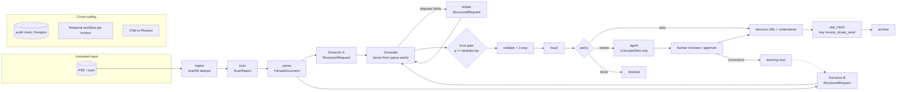

# Architecture

Sovereign AP Autopilot turns supplier invoices (PDF or scan, EN/AR) into validated UAE PINT AE
e-invoices on one 12 GB laptop GPU, with no outbound network at runtime. Source of truth: PRD §3,
§4, §6. Decisions: `docs/adr/0001`–`0006`.

## Components

| Module | Interface file | Responsibility |
|---|---|---|
| `apx/common` | `types.py`, `untrusted.py`, `errors.py`, `invoice.py`, `master.py`, `purchasing.py` | Shared value types (`BBox`, `FieldValue`, `Money`, `IdempotencyKey`), `UntrustedText`, typed errors, canonical `Invoice`, vendor master and users, `PurchaseOrder`/`PoLine` (needed by both `validate` and `fraud`) |
| `apx/ingest` | `interfaces.py` | Watch folder + upload, sha256 dedupe, content-addressed store, start `InvoiceWorkflow` |
| `apx/scan` | `interfaces.py` | Hidden/invisible text, zero-width and bidi controls, PDF metadata/attachments/JS, ModernBERT injection score |
| `apx/parse` | `interfaces.py` | Pages, words, lines, tables, reading order with boxes (PaddleOCR-VL doc-parser, pdfplumber) |
| `apx/extract` | `interfaces.py` | Field schema, tool-free Extractor A/B and arbiter, grounding of values onto parse words |
| `apx/trust` | `interfaces.py` | Per-field features, isotonic calibration, Learn-then-Test threshold |
| `apx/validate` | `interfaces.py` | VAT math, TRN, IBAN, mandatory fields, 3-way match |
| `apx/fraud` | `interfaces.py` | Typology rules, isolation forest, page similarity |
| `apx/policy` | `interfaces.py` | Capabilities, SoD, P1–P5 routing, action authorisation, proposals |
| `apx/einvoice` | `interfaces.py` | PINT AE UBL 2.1 builder, schematron validation |
| `apx/asp_mock` | `interfaces.py` | Exactly-once receipts and archive by idempotency key |
| `apx/agent` | `interfaces.py` | Exception agent, ops chat, read/propose tools, MCP server |
| `apx/audit` | `interfaces.py` | Hash-chained audit log, verifier |
| `apx/llm` | `interfaces.py` | llama-swap client, model registry (MLflow aliases), GPU stage scheduler |
| `apx/api` | `interfaces.py` | REST + SSE, JWT, roles; service boundary for the web UI |
| `apx/workflows` | `interfaces.py` | `InvoiceWorkflow` statuses, step names, activities |

Import direction (no cycles): `common` has no apx imports; `llm`, `parse`, `scan`, `validate`,
`fraud`, `audit`, `einvoice` import only `common`; `extract` adds `llm`, `parse`; `trust` adds
`extract`; `policy` adds `trust`, `validate`, `fraud`, `scan`; `asp_mock` adds `einvoice`;
`agent` adds `llm`, `policy`; `workflows` imports the pipeline modules; `api` adds `workflows`.

## Data flow

One Temporal `InvoiceWorkflow` per invoice (id derived from sha256) runs the activities in
`apx/workflows/interfaces.py`. Every activity appends an `AuditEvent` (I4). Side-effecting
activities carry `IdempotencyKey = "<invoice_id>:<step>"` (§6.4).

An invoice goes straight through only if every field is accepted by the trust gate and
validation, fraud and policy all pass (§6.1).

## Trust boundaries

1. **Document → system.** All document content is attacker-controlled. The scan stage flags hidden
   content before any model sees it; flags route to review or block (P4).
2. **Model output → fields.** Extractors return `RawField(name, value)` only; the schema forbids
   extra keys, so a model cannot supply boxes. `Grounder` attaches `word_ids`/`boxes` from parse
   words (I1). Accepted fields still pass validation, fraud and policy.
3. **Document → tool-enabled models.** Extractors and arbiter can only build `StructuredRequest`,
   which has no `tools` field (I2). The agent's `ToolRequest` receives document text only as
   `UntrustedText.quoted()` blocks, capped at 2000 chars each (I2).
4. **Agent → state.** Agent tools have `effect` `read` or `propose`; a `Proposal` executes only
   after a human with the right capability clicks and `PolicyEngine.authorize` allows it (P5, I3).
5. **Bank details.** Payment IBANs come only from `BankAccount` with `verified=True` and
   `source="admin_callback"` (P1), never from the invoice's `iban` field.
6. **Runtime → network.** App containers sit on a Compose network with `internal: true`; the only
   model endpoint is llama-swap on that network (C1, C6, ADR-0001).

## GPU stage and VRAM staging

`StageScheduler.stage(stage)` holds a single GPU lock and asks llama-swap to load the group for
that stage; the previous group is unloaded first (ADR-0002). Budget: peak ≤ 11.5 GB per stage.

| Stage | Resident models (est. VRAM) | Est. peak |
|---|---|---|
| `scan` | ModernBERT guard (<1 GB) | ~1 GB |
| `parse` | PaddleOCR-VL-1.6 (~2 GB) | ~2 GB |
| `extract` | Qwen3.5-9B A (~7 GB) + Qwen3.5-4B B (~3 GB) | ~10 GB + KV; sequential if measured > 11.5 GB |
| `arbitrate` | Gemma 4 12B QAT (~7.5 GB) | ~8 GB |
| `fraud` | Qwen3-Embedding-0.6B (~1.2 GB) | ~1.5 GB |
| `fraud_page` | Qwen3-VL-Embedding-2B (~4.5 GB), alone | ~5 GB |
| `agent` | Qwen3.5-9B (~7 GB) + text embeddings | ~8.5 GB |

Values are PRD estimates; `make smoke` (M0.5) records measured peaks in `reports/smoke.md`, and any
stage over budget switches to sequential loading within the stage.

**Model integrity.** `infra/models.lock.json` pins each repo to a revision SHA. LFS files (weights,
GGUF, mmproj) carry the Hub's sha256 and `make models` verifies it; small non-LFS files (configs,
tokenizers) have no Hub sha256 by API design, so they are verified by size and pinned revision only
(`sha256: null` in the lock).

## Host

Native Windows 11 + Git Bash + GNU make + Docker Desktop (WSL2 backend, GPU passthrough); ML
training in a uv environment with CUDA. See ADR-0006 for the deviation from PRD C3.
