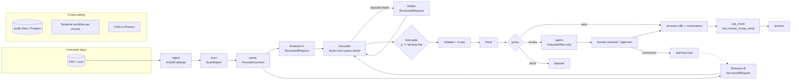

# Architecture

Sovereign AP Autopilot turns supplier invoices (PDF or scan, EN/AR) into validated UAE PINT AE
e-invoices on one 12 GB laptop GPU, with no outbound network at runtime. Source of truth: PRD §3,
§4, §6. Decisions: `docs/adr/0001`–`0015` (index at the end of this file).

## Components

| Module | Interface file | Responsibility |
|---|---|---|
| `apx/common` | `types.py`, `untrusted.py`, `errors.py`, `invoice.py`, `master.py`, `purchasing.py` | Shared value types (`BBox`, `FieldValue`, `Money`, `IdempotencyKey`), `UntrustedText`, typed errors, canonical `Invoice`, vendor master and users, `PurchaseOrder`/`PoLine` (needed by both `validate` and `fraud`) |
| `apx/ingest` | `interfaces.py` | Watch folder + upload, sha256 dedupe, content-addressed store, start `InvoiceWorkflow` |
| `apx/scan` | `interfaces.py` | Hidden/invisible text, zero-width and bidi controls, PDF metadata/attachments/JS, ModernBERT injection score |
| `apx/parse` | `interfaces.py` | Pages, words, lines, tables, reading order with boxes (PaddleOCR-VL doc-parser, pdfplumber) |
| `apx/extract` | `interfaces.py` | Field schema, tool-free Extractor A/B and arbiter, grounding of values onto parse words |
| `apx/trust` | `interfaces.py` | Per-field features, isotonic calibration, Learn-then-Test threshold |
| `apx/validate` | `interfaces.py` | VAT math, TRN, IBAN, mandatory fields, 3-way match |
| `apx/fraud` | `interfaces.py`, `page_similarity.py` | Typology rules, isolation forest, page similarity. Fraud owns the `PageEmbedder` port; `InMemoryPageSimilarityIndex` embeds pages through it and serves `DuplicateInvoiceRule.evaluate_similarity` (0.9 cosine threshold). An unavailable embedder raises, never passes (M8.1; not yet wired into the workflow) |
| `apx/policy` | `interfaces.py` | Capabilities, SoD, P1–P5 routing, action authorisation, proposals. P1 `select_payee(vendor, invoice_iban)` picks among admin-verified accounts only, and `route` pins the result as `RoutingDecision.payee` (ADR-0014) |
| `apx/einvoice` | `interfaces.py` | PINT AE UBL 2.1 builder, schematron validation |
| `apx/asp_mock` | `interfaces.py` | Exactly-once receipts and archive by idempotency key |
| `apx/agent` | `interfaces.py` | Exception agent, ops chat, read/propose tools, MCP server |
| `apx/audit` | `interfaces.py` | Hash-chained audit log, verifier |
| `apx/llm` | `interfaces.py`, `preflight.py`, `embedding.py` | llama-swap client, model registry (MLflow aliases), GPU stage scheduler. `preflight.py`: VRAM/RAM headroom check before every stage switch and the trainer (ADR-0013 addendum). `embedding.py`: `HttpPageEmbedder`, the local page-embedding client that structurally satisfies `apx.fraud.interfaces.PageEmbedder` |
| `apx/api` | `interfaces.py` | REST + SSE, JWT, roles; service boundary for the web UI |
| `apx/workflows` | `interfaces.py` | `InvoiceWorkflow` statuses, step names, activities |
| `ml/promotion` | `decide.py`, `evidence.py`, `retrain.py`, `errors.py` | Offline M10.2 champion/challenger pipeline behind `make retrain`: pure decider on gates G1-G11, then ordered side effects through injected protocols (ADR-0015). Not imported by `apx` |

Import direction (no cycles): `common` has no apx imports; `llm`, `parse`, `scan`, `validate`,
`fraud`, `audit`, `einvoice` import only `common` (plus the `db` infrastructure layer where a
module ships its own persistence adapter, e.g. `audit`'s Postgres chain writer -- never another
domain module); `extract` adds `llm`, `parse`; `trust` adds
`extract`; `policy` adds `trust`, `validate`, `fraud`, `scan`; `asp_mock` adds `einvoice`;
`agent` adds `llm`, `policy`; `workflows` imports the pipeline modules; `api` adds `workflows`.
Ports keep this direction: `fraud` never imports `llm`. It owns `PageEmbedder` and `PageVector`,
`apx.llm.embedding.HttpPageEmbedder` satisfies them structurally, and a composition root wires
the two (not yet wired into the workflow). `ml/promotion` imports `apx.common`, `apx.audit` and `evals`, and `apx` never imports `ml`.

## Data flow

One Temporal `InvoiceWorkflow` per invoice (id derived from sha256) runs the activities in
`apx/workflows/interfaces.py`. Every activity appends an `AuditEvent` (I4). Side-effecting
activities carry `IdempotencyKey = "<invoice_id>:<step>"` (§6.4).

An invoice goes straight through only if every field is accepted by the trust gate and
validation, fraud and policy all pass (§6.1).

## Trust boundaries

1. **Document → system.** All document content is attacker-controlled. The scan stage flags hidden
   content before any model sees it; flags route to review or block (P4).
2. **Model output → fields.** Extractors return `RawField(name, value)` only; the schema forbids
   extra keys, so a model cannot supply boxes. `Grounder` attaches `word_ids`/`boxes` from parse
   words (I1). Accepted fields still pass validation, fraud and policy.
3. **Document → tool-enabled models.** Extractors and arbiter can only build `StructuredRequest`,
   which has no `tools` field (I2). The agent's `ToolRequest` receives document text only as
   `UntrustedText.quoted()` blocks, capped at 2000 chars each (I2).
4. **Agent → state.** Agent tools have `effect` `read` or `propose`; a `Proposal` executes only
   after a human with the right capability clicks and `PolicyEngine.authorize` allows it (P5, I3).
5. **Bank details.** Payment IBANs come only from `BankAccount` with `verified=True` and
   `source="admin_callback"` (P1). The invoice's `iban` field can only select among those
   accounts, never introduce one. A selection among several, or an invoice IBAN that differs
   from a sole verified account, routes REVIEW (ADR-0014).
6. **Runtime → network.** App containers sit on a Compose network with `internal: true`; the only
   model endpoint is llama-swap on that network (C1, C6, ADR-0001).

## GPU stage and VRAM staging

`StageScheduler.stage(stage)` holds a single GPU lock and asks llama-swap to load the group for
that stage; the previous group is unloaded first (ADR-0002). Budget: peak ≤ 11.5 GB per stage.

| Stage | Resident models (est. VRAM) | Est. peak |
|---|---|---|
| `scan` | ModernBERT guard (<1 GB) | ~1 GB |
| `parse` | PaddleOCR-VL-1.6 (~2 GB) | ~2 GB |
| `extract` | Qwen3.5-9B A (~7 GB) + Qwen3.5-4B B (~3 GB) | ~10 GB + KV; sequential if measured > 11.5 GB |
| `arbitrate` | Gemma 4 12B QAT (~7.5 GB) | ~8 GB |
| `fraud` | Qwen3-Embedding-0.6B (~1.2 GB) | ~1.5 GB |
| `fraud_page` | Qwen3-VL-Embedding-2B (~4.5 GB), alone | ~5 GB |
| `agent` | Qwen3.5-9B (~7 GB) + text embeddings | ~8.5 GB |

Values are PRD estimates; `make smoke` (M0.5) records measured peaks in `reports/smoke.md`, and any
stage over budget switches to sequential loading within the stage.

**Model integrity.** `infra/models.lock.json` pins each repo to a revision SHA. LFS files (weights,
GGUF, mmproj) carry the Hub's sha256 and `make models` verifies it; small non-LFS files (configs,
tokenizers) have no Hub sha256 by API design, so they are verified by size and pinned revision only
(`sha256: null` in the lock).

## Host

Native Windows 11 + Git Bash + GNU make + Docker Desktop (WSL2 backend, GPU passthrough); ML
training in a uv environment with CUDA. See ADR-0006 for the deviation from PRD C3.

## Payee pin (P1, ADR-0014 §7)

`route` runs `select_payee` and stores `pin_payee(...)` as `RoutingDecision.payee`: masked IBAN,
match, verified count and `iban_sha256`, never the raw IBAN. The approval grant's
`subject_digest` binds the payee IBAN and match (ADR-0014 §6). `SqlInvoiceRecords.routed` persists the pin
in the `policy_route` decision, which the agent reads through `v_agent_invoices` (migration
`0008_agent_routed_payee`). `build_einvoice` receives the pin, re-selects on the live master and
builds only if the digest and match are unchanged. Otherwise it audits `activity:payee_changed`
and raises a non-retryable `PayeeChangedError`, and nothing is paid.

## Decision index

| ADR | Decision | Amendments |
|---|---|---|
| [0001](adr/0001-local-only-runtime.md) | Local-only runtime | 2026-09-22 `gateway` and `edge` network |
| [0002](adr/0002-serving-and-vram-staging.md) | Serving and VRAM staging with llama-swap groups | amended by 0013 |
| [0003](adr/0003-trust-boundary.md) | Trust boundary: typed extractor output, `UntrustedText`, I1/I2 | |
| [0004](adr/0004-trust-gate-method.md) | Trust gate: calibrated P(correct), Learn-then-Test | |
| [0005](adr/0005-eval-protocol.md) | Eval protocol: fixed splits, leakage test, scoreboard | M5.1 |
| [0006](adr/0006-host-deviation-native-windows.md) | Host: native Windows 11 + Docker Desktop | Smart App Control addendum |
| [0008](adr/0008-typed-boundary-and-capabilities.md) | Typed boundary and capability model | K5 amended by 0014 |
| [0009](adr/0009-extractor-b-training-and-trust-features.md) | Extractor B training and trust features | M7.2 outcome |
| [0010](adr/0010-agent-tool-contracts.md) | Agent tool contracts, prompts, MCP | |
| [0011](adr/0011-training-loop.md) | Extractor B training loop | 1-3 (2026-09-23); 4: `gpu.lock` liveness by flock |
| [0012](adr/0012-extraction-contract-and-b-training-inputs.md) | Extraction contract and B training inputs | 1: review corrections; 2: no money-path defaults in the UBL builder, `WORKER_BUYER_TRN` |
| [0013](adr/0013-live-serving-budget-and-backpressure.md) | Live serving budget and backpressure | M5.6a preflight headroom addendum |
| [0014](adr/0014-p1-multiple-verified-accounts.md) | P1 with several verified accounts: the invoice IBAN selects, never introduces | §7 payee pin, routing to build |
| [0015](adr/0015-promotion-gates.md) | M10.2 promotion gates for an Extractor B challenger | partial-apply recovery |
