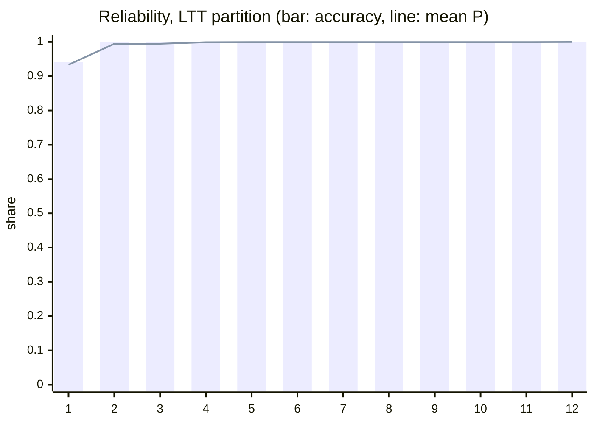
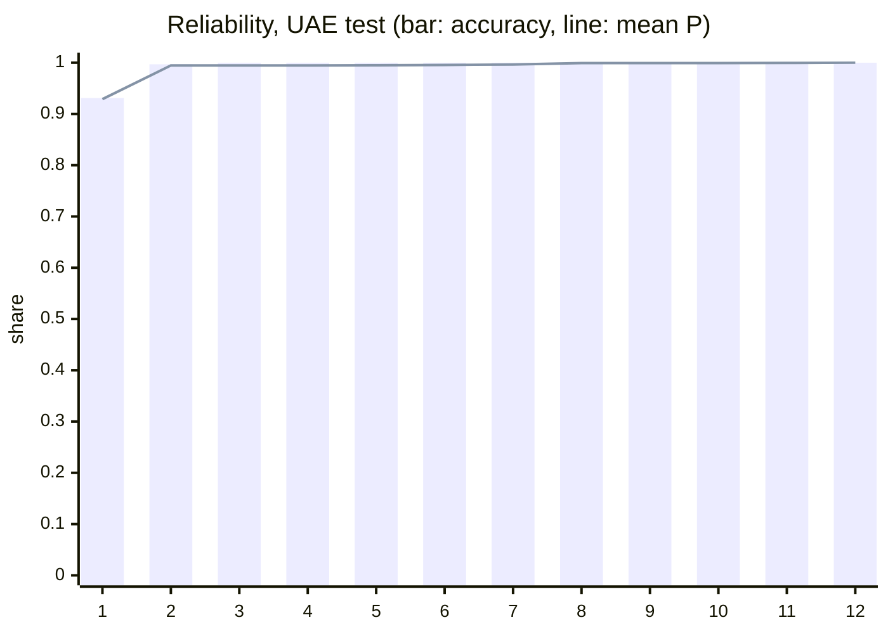
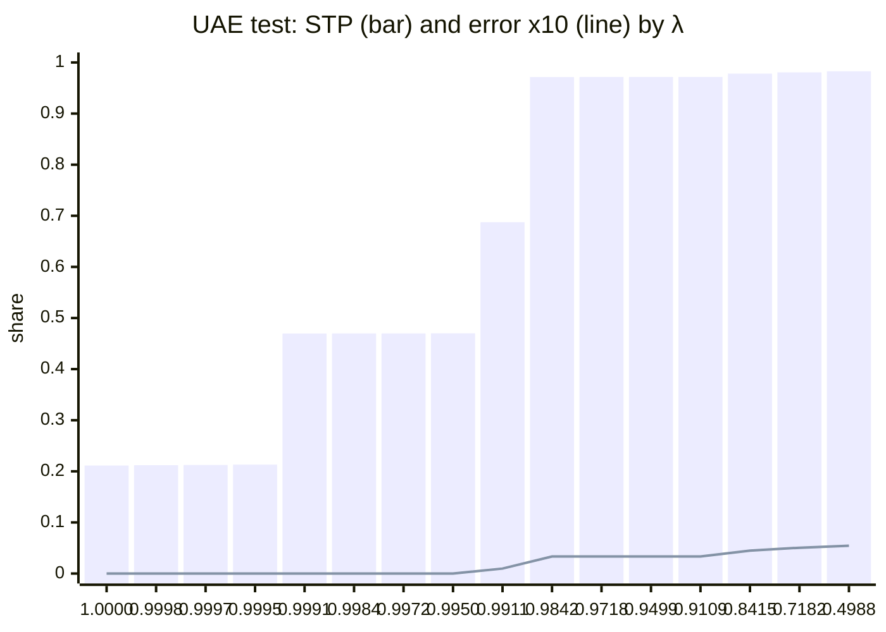

# Trust gate (calibration and Learn-then-Test)

Generated by `make calibrate` (`python -m evals.trust_gate calibrate`) at 2026-10-03T06:41:05+00:00. Calibrator artifact `f79cf6350572` (sha256 `dc59ae7ce071`, method isotonic) fitted on 750 UAE cal documents: A `extractor-a` gguf `6f5d30666c2d` prompt `cdcd2832034c55e3`; B none (champion-only, ADR-0018 §5). Activation: not activated: champion-only calibrator (ADR-0018 §5), test gate passed; fitted on the served champion A; the runtime serves Extractor B, which it does not calibrate.

## Learn-then-Test gate

| Check | Value | Gate |
|---|---|---|
| UAE test error among auto-accepted fields, alpha = 1% | PASS: 56/10318 = 0.5427% (gate <= 1%) | PASS |

The guarantee is marginal over fields of the synthetic factory distribution (ADR-0009 §8): not per field, language or invoice, and it does not transfer to real documents.

## Thresholds per alpha (LTT partition, delta = 5%, k_min = 1500)

| alpha | λ̂ | LTT accepted | LTT error | Test accepted | Test error [95% CI] | Test field STP | Test all-fields-accepted invoices |
|---:|---:|---:|---:|---:|---|---:|---:|
| 0.5% | 0.601893 | 6177 | 0.31% | 10305 | 0.52% [0.39%, 0.68%] | 98.14% | 665/750 |
| 1.0% | 0.498813 | 6188 | 0.37% | 10318 | 0.54% [0.41%, 0.70%] | 98.27% | 676/750 |
| 2.0% | 0.498813 | 6188 | 0.37% | 10318 | 0.54% [0.41%, 0.70%] | 98.27% | 676/750 |

Cal: 6286 LTT fields (6286 not hard-rejected), 4214 FIT fields. Hard-rejected fields (H1 invalid output, H2 disputed with no valid arbiter) are never accepted and stay in every STP denominator.

## Reliability

### LTT partition: ECE 0.0036 over 6286 fields

| Bin | P range | Mean P(correct) | Accuracy | Fields |
|---:|---|---:|---:|---:|
| 1 | 0.0000-0.9903 | 0.9333 | 0.9410 | 1948 |
| 2 | 0.9945-0.9945 | 0.9945 | 0.9992 | 1298 |
| 3 | 0.9949-0.9949 | 0.9949 | 1.0000 | 54 |
| 4 | 0.9993-0.9993 | 0.9993 | 1.0000 | 1661 |
| 5 | 0.9994-0.9994 | 0.9994 | 1.0000 | 1 |
| 6 | 0.9994-0.9994 | 0.9994 | 1.0000 | 1 |
| 7 | 0.9995-0.9995 | 0.9995 | 1.0000 | 1 |
| 8 | 0.9995-0.9995 | 0.9995 | 1.0000 | 1 |
| 9 | 0.9995-0.9995 | 0.9995 | 1.0000 | 1 |
| 10 | 0.9995-0.9995 | 0.9995 | 1.0000 | 1 |
| 11 | 0.9996-0.9996 | 0.9996 | 1.0000 | 1 |
| 12 | 0.9996-1.0000 | 1.0000 | 1.0000 | 1318 |

### UAE test: ECE 0.0014 over 10500 fields

| Bin | P range | Mean P(correct) | Accuracy | Fields |
|---:|---|---:|---:|---:|
| 1 | 0.0000-0.9903 | 0.9289 | 0.9311 | 3282 |
| 2 | 0.9945-0.9945 | 0.9945 | 0.9968 | 2191 |
| 3 | 0.9945-0.9945 | 0.9945 | 1.0000 | 1 |
| 4 | 0.9945-0.9945 | 0.9945 | 1.0000 | 1 |
| 5 | 0.9949-0.9949 | 0.9949 | 1.0000 | 90 |
| 6 | 0.9956-0.9956 | 0.9956 | 1.0000 | 1 |
| 7 | 0.9964-0.9964 | 0.9964 | 1.0000 | 1 |
| 8 | 0.9987-0.9993 | 0.9993 | 1.0000 | 2689 |
| 9 | 0.9993-0.9993 | 0.9993 | 1.0000 | 1 |
| 10 | 0.9993-0.9993 | 0.9993 | 1.0000 | 1 |
| 11 | 0.9994-0.9994 | 0.9994 | 1.0000 | 1 |
| 12 | 0.9994-1.0000 | 1.0000 | 1.0000 | 2241 |

## STP and error curves

Every 5th λ of the ADR-0009 §6 grid. STP = share of all fields auto-accepted; error = wrong share among them.

| λ | LTT STP | LTT error | Test STP | Test error |
|---:|---:|---:|---:|---:|
| 1.000000 | 20.74% | 0.00% | 21.14% | 0.00% |
| 0.999842 | 20.79% | 0.00% | 21.20% | 0.00% |
| 0.999718 | 20.87% | 0.00% | 21.25% | 0.00% |
| 0.999499 | 21.01% | 0.00% | 21.31% | 0.00% |
| 0.999109 | 47.50% | 0.00% | 46.97% | 0.00% |
| 0.998415 | 47.50% | 0.00% | 46.98% | 0.00% |
| 0.997182 | 47.50% | 0.00% | 46.98% | 0.00% |
| 0.994988 | 47.50% | 0.00% | 47.00% | 0.00% |
| 0.991087 | 69.01% | 0.02% | 68.74% | 0.10% |
| 0.984151 | 97.20% | 0.21% | 97.16% | 0.33% |
| 0.971816 | 97.20% | 0.21% | 97.17% | 0.33% |
| 0.949881 | 97.20% | 0.21% | 97.17% | 0.33% |
| 0.910875 | 97.20% | 0.21% | 97.17% | 0.33% |
| 0.841511 | 98.00% | 0.26% | 97.82% | 0.45% |
| 0.718162 | 98.27% | 0.31% | 98.07% | 0.51% |
| 0.498813 | 98.44% | 0.37% | 98.27% | 0.54% |

## Exchangeability caveats (ADR-0009 §8)

The binomial test treats fields as independent. Among LTT fields accepted at alpha = 1%: ANOVA ICC of errors by document = 0.0350, design effect DEFF = 1.447. If the gate fails, the §8 protocol runs before any change; test is never redrawn and λ̂ never tuned on test.

## Inputs

- Cal rows: A `4fee6784602e`, B `none`; cal documents digest `fdc2f7403b8f`.
- Test rows: `logs\extraction_a.adr0012.jsonl` (A), `none (champion-only)` (B).
